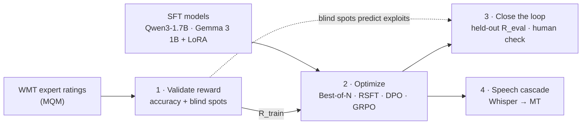

# Machine Translation with RLHF

**Validate the reward, optimize it, and find where it breaks.** This is a controlled study of reward-guided fine-tuning for English→German machine translation, extended to cascaded speech translation.

> **Status: Phase 1 done ✅ · Phase 2 code ready, first run pending.** The reward benchmark ran on a Kaggle T4 ([full report](results/p1/report/summary.md)). It chose **MetricX-24-QE** as the training reward and **COMET-22** as the held-out evaluator. Phase 2 (SFT, best-of-N, RSFT, DPO, GRPO) runs on Kaggle via [`notebooks/p2_training.ipynb`](notebooks/p2_training.ipynb). Phases 3–4 are designed in the [project proposal](docs/proposal.md) and the [system workflow](docs/workflow.md).

---

## The idea

RL fine-tuning (DPO, GRPO) lets a translation model optimize a quality metric instead of imitating one reference translation. But a model can only be as good as its reward: **whatever the reward cannot see, the policy is free to exploit.** This project therefore treats the reward as the main object of study and runs the whole loop:

| Phase | Question | Output |
|---|---|---|
| **1 · Validate the reward** | Which quality-estimation model agrees best with expert human judgements *when comparing translations of the same sentence*, and what are its blind spots? | Reward benchmark, blind-spot profile, and the choice of training reward |
| **2 · Optimize it** | Which method uses that reward best: best-of-N, rejection-sampling fine-tuning, DPO or GRPO? | Method benchmark: same start, same prompts, same reward budget |
| **3 · Close the loop** | Where did the training reward go up while real quality didn't, and did Phase 1 predict it? | Reward-hacking analysis with a held-out metric and a human check |
| **4 · Speech** | In a Whisper → MT cascade, are RL-tuned models more robust to recognition errors? | Robustness curves (quality vs. WER) and latency |



### Why within-source comparisons matter

Best-of-N picks the top candidate for a sentence. DPO learns from a better/worse pair for a sentence. GRPO normalizes rewards within a group of samples for a sentence. **All of them use the reward only to compare translations of the same source.** Phase 1 therefore measures exactly that, *within-source ranking accuracy* against expert judgements, and not just the usual global correlation.

## Setup at a glance

| | Choice |
|---|---|
| Language pair | **English → German.** One high-resource pair, so that the effect of the training method can be isolated |
| Policy models | **Qwen3-1.7B** (main, non-thinking mode) and **Gemma 3 1B-it** (replication, a different lab), both with LoRA. Two families, so findings are not one model's quirk |
| Reward candidates | CometKiwi-22 (QE) and MetricX-24 in QE mode. COMET-22, MetricX-24 with references and chrF serve as reference-based comparisons |
| Human judgements | WMT22–24 en→de MQM via [`mt-metrics-eval`](https://github.com/google-research/mt-metrics-eval). WMT22 + WMT23 decide the reward choice; WMT24 (newest, LLM-era systems) is a separate check |
| Alignment methods | Best-of-N reranking · rejection-sampling FT (RSFT) · DPO · GRPO · GRPO + guards |
| Anchors | OPUS-MT en-de (classic NMT) · each policy model zero-shot |
| Text test sets | FLORES-200 devtest (primary), WMT24 en→de (secondary); de→en and en→zh as a forgetting check |
| Speech test sets | FLEURS (English), MuST-C tst-COMMON (en→de). ASR: Whisper tiny → large-v3-turbo |
| Hardware | One 24 GB GPU; free T4s for debugging and Phase 1 scoring. About 25–45 GPU-hours in total |

## Rules of the experiment

- **Change one thing at a time.** Every alignment method starts from the same SFT checkpoint and uses the same 5k prompts and the same reward budget (5k prompts × 8 samples = 40k reward calls).
- **Never grade a model with its own reward.** Final quality is judged by a reward from a *different model family* (R_eval), by reference-based metrics and by a human check. The training reward (R_train) is reported only to show the over-optimization gap.
- **Select on dev, test once.** Checkpoints are chosen on FLORES dev, and test sets are scored once per final system.
- **Report uncertainty.** System differences come with paired-bootstrap 95% confidence intervals.

## Benchmarks

*Results are filled in as experiments complete.*

**A · Reward models vs. expert judgements** ✅ ([full report](results/p1/report/summary.md))

38,936 expert-rated (MQM) English→German translations: WMT22 and WMT23 (sentence-level, pooled; they decide the choice) and WMT24 (newer, LLM-era systems, paragraph-level; reported separately). *Within-source accuracy* is the share of same-source translation pairs where the reward agrees with the experts on which one is better (50% = chance). Brackets are 95% bootstrap CIs.

| Reward | Needs reference | Within-source acc. (WMT22+23) ↑ | WMT24 ↑ | Kendall τ_b (WMT22 / 23) ↑ | Weakest blind-spot probe (detection) | Speed on T4 (inputs/s) |
|---|---|---|---|---|---|---|
| MetricX-24 (ref) | yes | 68% [67, 69] | 65% | 0.42 / 0.36 | wrong language 96% | 28 |
| COMET-22 · **R_eval** | yes | 66% [65, 67] | 67% | 0.34 / 0.34 | number 89% | 36 |
| MetricX-24 (QE) · **R_train** | no | 64% [63, 65] | 61% | 0.38 / 0.30 | number 84% | 44 |
| CometKiwi-22 | no | 62% [61, 62] | 59% | 0.23 / 0.29 | **wrong language 28%** | 58 |
| chrF | yes | 60% [59, 61] | 59% | 0.21 / 0.16 | repetition 84% | 2,399 |
| BLEU | yes | 60% [59, 61] | 58% | 0.17 / 0.15 | negation 77% | 6,744 |

What Phase 1 found:
- **MetricX-24-QE is the best affordable training reward.** It beats CometKiwi-22, a widely used QE reward in RL-for-MT work, by 2.2 points within-source (95% CI [1.2, 3.4]). The lead holds on WMT24 (61% vs. 59%).
- **CometKiwi-22 prefers a correct translation into the *wrong language* over the German one 72% of the time** (detection 28%, CI [24, 32]). A policy trained on it would get no penalty for drifting off-target, which makes it a predicted exploit to test in Phase 3.
- **Number errors are cheap for MetricX-24-QE.** It catches a changed number 84% of the time (CI [76, 91], n = 82) and lowers the score by only 0.3 SD. This is the main blind spot to watch, and to guard against with a number-mismatch penalty, once GRPO trains on it.
- **Even the best rewards agree with experts on only about 2 of 3 same-source pairs.** Many reward-labelled preference pairs will therefore be wrong, especially when the two scores are close. This motivates the score-margin filter for DPO pairs and the held-out evaluation.
- **Sanity checks pass.** Our CometKiwi-22 and COMET-22 scores reproduce the scores stored with WMT24 (Pearson 0.999 and 1.000), chrF and BLEU match exactly, and the tie-calibrated accuracy matches mt-metrics-eval's implementation to 1e-13. Larger models whose scores ship with WMT24 do better as QE rewards (the official MetricX-24-QE submission 66%, XCOMET-QE 65%), but they are too big to train with on one GPU.

**B · Alignment methods** (FLORES-200 devtest, en→de)

| System | R_eval ↑ | COMET-22 ↑ | chrF ↑ | R_train ↑ *(trained on)* | Exploit rate ↓ | Inference cost |
|---|---|---|---|---|---|---|
| OPUS-MT en-de | – | – | – | – | – | 1× (≈74M params) |
| Qwen3-1.7B zero-shot | – | – | – | – | – | 1× |
| SFT | – | – | – | – | – | 1× |
| SFT + best-of-8 | – | – | – | – | – | 8 samples + 8 reward calls |
| RSFT | – | – | – | – | – | 1× |
| DPO | – | – | – | – | – | 1× |
| GRPO | – | – | – | – | – | 1× |
| GRPO + guards | – | – | – | – | – | 1× |

**C · Speech cascade** (Whisper → MT, FLEURS English → German)

| MT system | Gold transcript | Whisper-tiny | Whisper-small | Whisper-large-v3-turbo | Drop gold → tiny |
|---|---|---|---|---|---|
| *ASR WER* | *0* | – | – | – | |
| SFT | – | – | – | – | – |
| DPO | – | – | – | – | – |
| GRPO | – | – | – | – | – |

## How it works

| Phase | In short | Details |
|---|---|---|
| 1 | Score WMT system outputs (already rated by experts) with each candidate reward and measure agreement. Perturb good translations (omissions, number changes, wrong language …) to map each reward's blind spots. Pick R_train and a held-out R_eval from another model family. | [workflow §4](docs/workflow.md#4-phase-1-validate-the-reward) |
| 2 | SFT a LoRA adapter, sample 8 candidates per prompt and score them with R_train, then run best-of-N, RSFT, DPO and GRPO from the same checkpoint. | [workflow §5](docs/workflow.md#5-phase-2-optimize-the-reward) |
| 3 | Evaluate with R_eval, COMET-22 and chrF. Track over-optimization curves, run hacking diagnostics, audit "suspicious wins", do a human A/B check, and test forgetting on untrained directions. | [workflow §6](docs/workflow.md#6-phase-3-close-the-loop) |
| 4 | Transcribe English audio with five Whisper sizes, translate with every MT system, and plot translation quality against WER. Measure latency. | [workflow §7](docs/workflow.md#7-phase-4-cascaded-speech-translation) |

A worked example that follows one sentence through the whole system is in [workflow §8](docs/workflow.md#8-end-to-end-walkthrough-one-sentence-through-the-system).

## Repository layout

```
machine-translation-with-RLHF/
├── configs/p2/         # one YAML per Phase 2 system: sft, rsft, dpo, grpo, grpo_guarded, grpo_cometkiwi
├── docs/               # proposal.md, workflow.md
├── notebooks/          # p1_reward_benchmark.ipynb, p2_training.ipynb (Kaggle / Colab)
├── scripts/            # one CLI per pipeline step: p1_* (reward benchmark), p2_* (training, translation)
├── src/mtrlhf/
│   ├── rewards/        # one interface: score(src, hyp, ref=None) → higher is better
│   │                   #   CometKiwi / COMET-22, MetricX-24, chrF / BLEU; guards.py = rule-based exploit checks
│   ├── meta_eval/      # mt-metrics-eval loader, agreement statistics, blind-spot probes, report
│   ├── data/           # prompt template, News Commentary training data, FLORES-200 / WMT24 test sets
│   ├── train/          # SFT / RSFT, DPO, GRPO on TRL + LoRA; GRPO reward functions
│   └── models.py       # systems as LoRA adapter chains, Hub-mirrored checkpoint store, batched generation
├── tests/              # unit tests + end-to-end runs of Phase 1 and Phase 2 on tiny fake data (CPU)
└── results/            # finished results, one folder per phase
```

Planned for later phases: Phase 3 analysis scripts, `src/mtrlhf/speech/` and `human_eval/` (see [workflow](docs/workflow.md)).

## Running Phase 1

**On Kaggle or Colab (recommended).** Open [`notebooks/p1_reward_benchmark.ipynb`](notebooks/p1_reward_benchmark.ipynb), choose a T4 GPU, add a Hugging Face token as the `HF_TOKEN` secret (after accepting the [CometKiwi license](https://huggingface.co/Unbabel/wmt22-cometkiwi-da)), and run all cells. It takes about 2–3 hours. With an optional `GH_TOKEN` secret (a fine-grained GitHub token for this repository with *Contents: Read and write*), the notebook pushes the scores to `results/p1/` after each reward. Results then survive a stopped session, and a re-run continues where the last one stopped.

**Anywhere else:**

```bash
pip install -e ".[phase1,dev]"
pip install --no-deps unbabel-comet==2.2.7 "git+https://github.com/google-research/mt-metrics-eval"
```

```bash
python scripts/p1_build_inputs.py --run runs/p1 --download     # WMT22–24 en-de with MQM, probes (CPU)
python scripts/p1_score.py --run runs/p1 --rewards chrf bleu cometkiwi22 comet22 metricx24_qe metricx24_ref   # GPU
python scripts/p1_analyze.py --run runs/p1                     # report in runs/p1/report/summary.md (CPU)
```

```bash
pytest   # unit tests and an end-to-end run on a small fake dataset (no GPU, no downloads)
```

## Running Phase 2

**On Kaggle (recommended).** Open [`notebooks/p2_training.ipynb`](notebooks/p2_training.ipynb) with **GPU T4 ×2**, a *write* `HF_TOKEN` (adapters are saved to a private Hugging Face repo as they finish) and `GH_TOKEN`. Run it four times: `MODEL = "qwen3-1.7b"` with `PART = "A"` (data, SFT, sampling, RSFT, DPO; ~4–5 h), then `PART = "B"` (GRPO and guarded GRPO side by side; ~5–6 h), then the same two parts for `MODEL = "gemma3-1b"`, which is slower in fp32. These times are rough estimates. Every step skips work that is already saved.

**Anywhere else:**

```bash
pip install -e ".[phase1,phase2,dev]"
pip install --no-deps unbabel-comet==2.2.7 "git+https://github.com/google-research/mt-metrics-eval"
```

```bash
python scripts/p2_prepare_data.py --out data/p2                      # News Commentary, FLORES-200, WMT24
M=qwen3-1.7b                                                              # then M=gemma3-1b
python scripts/p2_train.py --model $M --config configs/p2/sft.yaml       # S0: the shared starting point
python scripts/p2_sampling_pilot.py --model $M --write results/p2/sampling.json  # once: one sampling setting for all
python scripts/p2_sample.py --model $M --system sft --n 8 --reward metricx24_qe   # 5k prompts x 8, scored
python scripts/p2_build_pairs.py --model $M                              # RSFT targets, DPO pairs
python scripts/p2_train.py --model $M --config configs/p2/rsft.yaml      # main model only
python scripts/p2_train.py --model $M --config configs/p2/dpo.yaml
python scripts/p2_train.py --model $M --config configs/p2/grpo.yaml      # guards logged only
python scripts/p2_train.py --model $M --config configs/p2/grpo_guarded.yaml   # guards as penalties
python scripts/p2_translate.py --model $M --systems base opus-mt sft rsft dpo grpo-step625 grpo_guarded-step625
python scripts/p2_translate.py --model $M --systems sft --best-of 8
python scripts/p2_translate.py --model $M --summary-only --score chrf metricx24_qe comet22
```

Add `--debug` to `p2_train.py` for a few-step run with the real model and a separate checkpoint folder. Every Phase 2 script takes `--model qwen3-1.7b | gemma3-1b`, which selects the model, its per-model folders (`ckpt/<model>/`, `results/p2/<model>/`) and its batch sizes. Gemma runs in fp32 on a T4, because it overflows in fp16.

## Later phases (target interface)

```bash
# Phase 3: evaluation and hacking report
python scripts/p3_evaluate.py --systems all --testsets flores_devtest wmt24
python scripts/p3_hacking_report.py
```

```bash
# Phase 4: speech cascade
python scripts/p4_transcribe.py --whisper tiny base small medium large-v3-turbo --testsets fleurs_en mustc_tst_common
python scripts/p4_cascade_eval.py --systems all
```

## Roadmap

- [x] **M1a** Phase 1 code: reward interface (CometKiwi, COMET-22, MetricX-24, chrF, BLEU), mt-metrics-eval loader, agreement statistics, blind-spot probes, Kaggle/Colab notebook, tests
- [x] **M1b** Phase 1 run on a Kaggle T4 → reward benchmark (A) and blind-spot profile → R_train = MetricX-24-QE, R_eval = COMET-22
- [x] **M2a/M3a** Phase 2 code: data pipeline, SFT, sampling and scoring, best-of-N, RSFT, DPO, Kaggle notebook, tests
- [ ] **M2b/M3b** Phase 2 Part A run → `sft`, `sft+bo8`, `rsft`, `dpo` ← *minimum viable project*
- [ ] **M4** GRPO and guarded GRPO (code ready, run = Part B), KL sweep, over-optimization curves → benchmark B
- [ ] **M5** Hacking diagnostics, predicted vs. observed exploits, human check, forgetting check
- [ ] **M6** Whisper sweep, cascade evaluation, latency → benchmark C; final write-up
- [ ] *Stretch:* CPO · MBR · cross-reward GRPO (2×2) · noise-aware GRPO on ASR transcripts

## Tech stack

PyTorch · Hugging Face Transformers, PEFT and **TRL** (SFT / DPO / GRPO) · **vLLM** · `unbabel-comet` · MetricX · `mt-metrics-eval` · sacreBLEU · Whisper · jiwer · Weights & Biases

## Licenses and data terms

The code is released under the [MIT License](LICENSE). Some models and datasets have their own terms:

- **CometKiwi** (`Unbabel/wmt22-cometkiwi-da`) is **gated** on Hugging Face and licensed **CC BY-NC-SA 4.0, for non-commercial use only**. Accept the license on its model page before downloading.
- **MuST-C** is CC BY-NC-ND 4.0 and requires registration. FLORES-200 is CC BY-SA 4.0, and FLEURS is CC BY 4.0.
- MetricX-24, COMET-22, Qwen3 and Whisper are under permissive licenses (Apache-2.0 / MIT). **Gemma 3** is gated under the Gemma Terms of Use; accept them on its model page.

This is a non-commercial research project.

## Key references

Rafailov et al. 2023 (DPO) · Shao et al. 2024 (GRPO) · Gulcehre et al. 2023 (ReST) · Xu et al. 2024 (CPO) · He et al. 2024 (QE as a reward model for MT) · Gao et al. 2023 (reward over-optimization) · Freitag et al. 2021 (MQM) · Deutsch et al. 2023 (tie-calibrated meta-evaluation) · Juraska et al. 2024 (MetricX-24) · Radford et al. 2023 (Whisper). The full list is in the [proposal](docs/proposal.md#references).
