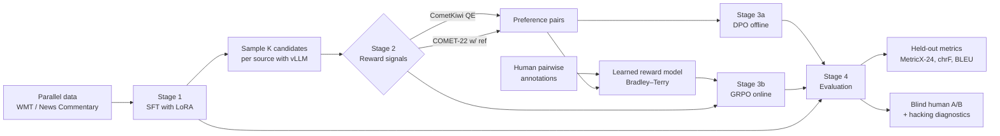

# Machine Translation with RLHF

**Aligning a small LLM translator with human preferences, using reward models, DPO and GRPO, and checking that the gains are real rather than reward hacking.**

> **Status: 🚧 design phase.** This README is the project's design document. The commands and repository layout below are the *target* interface, and the results table fills in as each experiment finishes.

---

## Why this project

Neural machine translation (NMT) systems are usually trained with maximum likelihood: they learn to imitate a single reference translation. This has three problems:

1. **References are noisy and singular.** A sentence has many good translations, but MLE rewards only one, and it also teaches the model whatever errors the reference contains.
2. **The training objective is not the goal.** People judge translations on adequacy, fluency and terminology, not on token overlap with a reference.
3. **Exposure bias.** The model is trained on gold prefixes but has to decode from its own outputs.

Reinforcement learning from human feedback (RLHF) and preference optimization changed how general-purpose LLMs are aligned. This project asks whether the same toolkit makes a **small (~1.5B) open LLM a better translator**, judged by **held-out metrics and humans**. The main risk is *Goodhart's law*: a model trained against a quality metric learns to game that metric, so the project treats separating real gains from reward hacking as a core deliverable.

## Research questions

| # | Question |
|---|----------|
| **RQ1** | Does preference optimization (offline **DPO**, online **GRPO**) beat a strong supervised fine-tuning (SFT) baseline on held-out metrics and in blind human evaluation? |
| **RQ2** | Which feedback signal works best: a reference-based metric (COMET), reference-free quality estimation (CometKiwi), a **learned reward model** trained on human preferences, or a composite of these? |
| **RQ3** | How much **reward hacking** occurs (off-target language, length exploitation, hallucination, copying the source), and which mitigations work (KL control, composite rewards, explicit penalties)? |
| **RQ4** | Is training-time alignment worth it compared with **inference-time** quality-aware decoding (best-of-N reranking with a QE model)? And can an aligned 1.5B model close the gap to a 7B model? |

## Scope

| | Default choice | Rationale |
|---|---|---|
| Language pairs | **Chinese → English** and **English → Chinese** | High-resource pair with recent WMT test sets. A native speaker can run the human evaluation. |
| Policy model | `Qwen2.5-1.5B-Instruct` with LoRA | Strong multilingual base that trains on a single GPU. Any Hugging Face causal LM can be swapped in through the config. |
| Reference "big" model | `Qwen2.5-7B-Instruct` (zero-shot) | Gives an upper bound for the "small aligned model vs. large model" comparison. |
| Compute budget | 1× 24–80 GB GPU | Keeps the project reproducible for individuals. |

## Approach



### Stage 0: Data

- **SFT data:** about 50k zh↔en sentence pairs from WMT training data (e.g. News Commentary), **filtered by QE score** so that the model imitates only high-quality references.
- **RL prompts:** source-side sentences only. Because the main reward is reference-free, online RL can use *monolingual* text, which is cheap and plentiful.
- **Evaluation:** WMT23 general test sets (zh→en, en→zh) and FLORES-200 `devtest`. No test data is used for training, filtering or checkpoint selection. FLORES `dev` is the validation set.

### Stage 1: Supervised fine-tuning (baseline)

LoRA fine-tuning with a fixed translation prompt template. This is the reference policy for both DPO and GRPO, and it is the baseline every later model has to beat.

### Stage 2: Reward signals

| Signal | Type | Used for |
|---|---|---|
| **CometKiwi** (`wmt22-cometkiwi-da`) | Reference-free QE | Main RL reward and preference-pair labelling |
| **COMET-22** (`wmt22-comet-da`) | Reference-based | Preference labelling when a reference exists |
| **Learned reward model** | Bradley–Terry model on the SFT backbone | Trained on metric-derived pairs plus a small set of human pairwise judgements, then validated by agreement with held-out human labels |
| **Penalties** | Rule-based | Wrong output language, extreme length ratio, verbatim source copying, repetition |

**Preference pairs** are built by sampling *K* = 8 translations per source from the SFT model, scoring them, and keeping the (best, worst) pair only when the score margin is above a threshold. This filters out pairs where the metric can't tell the candidates apart.

### Stage 3: Preference optimization

- **3a. DPO (offline):** trains directly on preference pairs, with no reward model at train time. It is cheap and stable, so it serves as the first alignment baseline.
- **3b. GRPO (online):** samples a group of translations per source, scores them with the reward, and uses group-relative advantages, so no value network is needed. A KL penalty to the SFT policy limits drift. This is where the composite reward and the anti-hacking penalties are tested.
- *(Optional)* **CPO**, the translation-specific preference objective used in ALMA-R, as an extra comparison.

### Stage 4: Evaluation

The rule is that **the metric a model was trained on is never its headline metric.**

| Metric | Role |
|---|---|
| **MetricX-24** (↓) | Primary *held-out* automatic metric (different model family from the COMET rewards) |
| COMET-22 | Secondary. Reported, but marked as non-held-out for models trained on it |
| chrF / BLEU (sacreBLEU) | Surface-overlap sanity checks |
| CometKiwi | The training reward, shown for transparency to reveal over-optimization |
| **Human A/B** | 200 segments per direction, blind pairwise (SFT vs. best aligned model), 2 annotators, win rate with Cohen's κ |
| LLM-as-judge | Cheap pairwise preference at scale, calibrated against the human labels |

## Guarding against reward hacking

A model trained on a learned metric will find that metric's blind spots, so every run logs these diagnostics:

| Failure mode | Detector |
|---|---|
| Off-target language | Language-ID rate on outputs |
| Length exploitation | Output/source length-ratio distribution |
| Untranslated copying | Character overlap between source and output |
| Hallucination / omission | Low cross-lingual source–output similarity (e.g. LaBSE) |
| Over-optimization | Divergence between the training reward (↑) and held-out MetricX (↓). The checkpoint is chosen on the held-out metric |

The mitigations under study are KL coefficient sweeps, the composite reward (QE + learned RM), and explicit penalties. Each is reported as an ablation.

## Experiment matrix

| ID | System | Feedback signal | Answers |
|---|---|---|---|
| E0 | Qwen2.5-1.5B zero-shot | none | Lower bound |
| E1 | SFT | references | Baseline |
| E2 | SFT + best-of-8 QE reranking | CometKiwi (inference time) | RQ4 |
| E3 | DPO | CometKiwi pairs | RQ1, RQ2 |
| E4 | DPO | learned RM / human pairs | RQ2 |
| E5 | GRPO | CometKiwi | RQ1, RQ3 |
| E6 | GRPO | composite (QE + RM − penalties) | RQ2, RQ3 |
| E7 | Qwen2.5-7B zero-shot | none | RQ4 upper reference |

## Results

*To be filled as experiments complete (WMT23, zh→en / en→zh).*

| ID | System | MetricX-24 ↓ | COMET-22 ↑ | chrF ↑ | BLEU ↑ | CometKiwi ↑ *(train reward)* | Off-target % ↓ | Human win rate vs. SFT |
|---|---|---|---|---|---|---|---|---|
| E0 | Zero-shot | – | – | – | – | – | – | – |
| E1 | SFT | – | – | – | – | – | – | – |
| E2 | SFT + QE rerank | – | – | – | – | – | – | – |
| E3 | DPO (QE pairs) | – | – | – | – | – | – | – |
| E5 | GRPO (QE) | – | – | – | – | – | – | – |
| E6 | GRPO (composite) | – | – | – | – | – | – | – |
| E7 | 7B zero-shot | – | – | – | – | – | – | – |

## Repository layout (planned)

```
machine-translation-with-RLHF/
├── configs/                 # YAML configs, one per stage / experiment
│   ├── sft.yaml
│   ├── reward_model.yaml
│   ├── dpo.yaml
│   └── grpo.yaml
├── scripts/
│   ├── prepare_data.py      # download, clean, QE-filter parallel data
│   ├── generate_candidates.py   # K samples per source with vLLM
│   ├── build_preferences.py     # score candidates → (chosen, rejected) pairs
│   └── evaluate.py          # all metrics + hacking diagnostics → reports/
├── src/mtrlhf/
│   ├── data/                # prompt templates, dataset builders
│   ├── rewards/             # cometkiwi.py, comet.py, reward_model.py, composite.py, penalties.py
│   ├── train/               # sft.py, reward_model.py, dpo.py, grpo.py (thin wrappers over TRL)
│   └── eval/                # metrics.py, hacking_checks.py, llm_judge.py, human_eval.py
├── human_eval/              # annotation guidelines, blinded sheets, agreement analysis
├── reports/                 # result tables and figures
└── tests/
```

## Getting started (target interface)

```bash
# 1. Environment
pip install -e ".[dev]"

# 2. Data
python scripts/prepare_data.py --pairs zh-en en-zh --qe-filter 0.80

# 3. Supervised baseline
python -m mtrlhf.train.sft --config configs/sft.yaml

# 4. Build preference data from SFT samples
python scripts/generate_candidates.py --model outputs/sft --num-samples 8
python scripts/build_preferences.py --scorer cometkiwi --min-margin 0.05

# 5. Align
python -m mtrlhf.train.dpo  --config configs/dpo.yaml
python -m mtrlhf.train.grpo --config configs/grpo.yaml

# 6. Evaluate on held-out test sets
python scripts/evaluate.py --model outputs/grpo --testset wmt23 \
    --metrics metricx24,comet22,chrf,bleu --hacking-checks
```

## Roadmap

- [ ] Data pipeline with QE filtering, plus WMT23 / FLORES-200 loaders
- [ ] Evaluation harness (metrics, hacking diagnostics, LLM judge) *built first, so every later stage is measured the same way*
- [ ] E0–E1: zero-shot and SFT baselines
- [ ] E2: best-of-N QE reranking
- [ ] Candidate generation and preference-pair construction
- [ ] E3: DPO
- [ ] Human annotation round 1 (pairwise) → learned reward model → E4
- [ ] E5–E6: GRPO with QE and composite rewards, plus KL / penalty ablations
- [ ] Human A/B evaluation of the best system vs. SFT
- [ ] Write-up: results, failure-mode gallery, lessons learned

## Tech stack

PyTorch · Hugging Face Transformers, PEFT (LoRA) and **TRL** (SFT / Reward / DPO / GRPO trainers) · **vLLM** for fast sampling · `unbabel-comet` · MetricX · sacreBLEU · Weights & Biases

## References

- Ouyang et al. (2022). *Training language models to follow instructions with human feedback.*
- Rafailov et al. (2023). *Direct Preference Optimization: Your Language Model is Secretly a Reward Model.*
- Shao et al. (2024). *DeepSeekMath: Pushing the Limits of Mathematical Reasoning in Open Language Models* (introduces GRPO).
- Xu et al. (2024). *Contrastive Preference Optimization: Pushing the Boundaries of LLM Performance in Machine Translation.*
- He et al. (2024). *Improving Machine Translation with Human Feedback: An Exploration of Quality Estimation as a Reward Model.*
- Gao et al. (2023). *Scaling Laws for Reward Model Overoptimization.*
- Fernandes et al. (2022). *Quality-Aware Decoding for Neural Machine Translation.*
- Rei et al. (2022). *COMET-22* and *CometKiwi*, WMT 2022 shared-task submissions.
- Juraska et al. (2024). *MetricX-24: The Google Submission to the WMT 2024 Metrics Shared Task.*
- Freitag et al. (2021). *Experts, Errors, and Context: A Large-Scale Study of Human Evaluation for Machine Translation.*

## License

Code is released under the [MIT License](LICENSE). Some evaluation and reward models have their own licenses: CometKiwi and xCOMET are CC BY-NC-SA 4.0, for non-commercial research use only.
