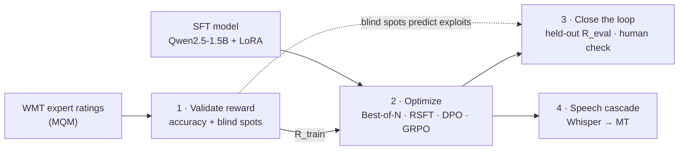

# Machine Translation with RLHF

**Validate the reward, optimize it, and find where it breaks.** This is a controlled study of reward-guided fine-tuning for English→German machine translation, extended to cascaded speech translation.

> **Status: 🚧 Phase 1 code ready, first run pending.** The reward benchmark runs on a free Kaggle or Colab T4 via [`notebooks/p1_reward_benchmark.ipynb`](notebooks/p1_reward_benchmark.ipynb). Phases 2–4 are designed in the [project proposal](docs/proposal.md) and the [system workflow](docs/workflow.md). The benchmark tables below fill in as experiments finish.

---

## The idea

RL fine-tuning (DPO, GRPO) lets a translation model optimize a quality metric instead of imitating one reference translation. But a model can only be as good as its reward: **whatever the reward cannot see, the policy is free to exploit.** This project therefore treats the reward as the main object of study and runs the whole loop:

| Phase | Question | Output |
|---|---|---|
| **1 · Validate the reward** | Which quality-estimation model agrees best with expert human judgements *when comparing translations of the same sentence*, and what are its blind spots? | Reward benchmark, blind-spot profile, and the choice of training reward |
| **2 · Optimize it** | Which method uses that reward best: best-of-N, rejection-sampling fine-tuning, DPO or GRPO? | Method benchmark: same start, same prompts, same reward budget |
| **3 · Close the loop** | Where did the training reward go up while real quality didn't, and did Phase 1 predict it? | Reward-hacking analysis with a held-out metric and a human check |
| **4 · Speech** | In a Whisper → MT cascade, are RL-tuned models more robust to recognition errors? | Robustness curves (quality vs. WER) and latency |



### Why within-source comparisons matter

Best-of-N picks the top candidate for a sentence. DPO learns from a better/worse pair for a sentence. GRPO normalizes rewards within a group of samples for a sentence. **All of them use the reward only to compare translations of the same source.** Phase 1 therefore measures exactly that, *within-source ranking accuracy* against expert judgements, and not just the usual global correlation.

## Setup at a glance

| | Choice |
|---|---|
| Language pair | **English → German.** One high-resource pair, so that the effect of the training method can be isolated |
| Policy | Qwen2.5-1.5B-Instruct + LoRA (0.5B for debugging) |
| Reward candidates | CometKiwi-22 (QE) and MetricX-24 in QE mode. COMET-22, MetricX-24 with references and chrF serve as reference-based comparisons |
| Human judgements | WMT22–23 en→de MQM via [`mt-metrics-eval`](https://github.com/google-research/mt-metrics-eval) |
| Alignment methods | Best-of-N reranking · rejection-sampling FT (RSFT) · DPO · GRPO · GRPO + guards |
| Anchors | OPUS-MT en-de (classic NMT) · Qwen2.5-1.5B zero-shot · Qwen2.5-7B zero-shot |
| Text test sets | FLORES-200 devtest (primary), WMT24 en→de (secondary); de→en and en→zh as a forgetting check |
| Speech test sets | FLEURS (English), MuST-C tst-COMMON (en→de). ASR: Whisper tiny → large-v3-turbo |
| Hardware | One 24 GB GPU; free T4s for debugging and Phase 1 scoring. About 25–45 GPU-hours in total |

## Rules of the experiment

- **Change one thing at a time.** Every alignment method starts from the same SFT checkpoint and uses the same 5k prompts and the same reward budget (5k prompts × 8 samples = 40k reward calls).
- **Never grade a model with its own reward.** Final quality is judged by a reward from a *different model family* (R_eval), by reference-based metrics and by a human check. The training reward (R_train) is reported only to show the over-optimization gap.
- **Select on dev, test once.** Checkpoints are chosen on FLORES dev, and test sets are scored once per final system.
- **Report uncertainty.** System differences come with paired-bootstrap 95% confidence intervals.

## Benchmarks

*Results are filled in as experiments complete.*

**A · Reward models vs. expert judgements** (WMT22–23 en→de, MQM)

| Reward | Needs reference | Within-source acc. ↑ | Segment Kendall τ ↑ | System pairwise acc. ↑ | Probe detection ↑ | Throughput |
|---|---|---|---|---|---|---|
| CometKiwi-22 | no | – | – | – | – | – |
| MetricX-24 (QE) | no | – | – | – | – | – |
| COMET-22 | yes | – | – | – | – | – |
| MetricX-24 (ref) | yes | – | – | – | – | – |
| chrF | yes | – | – | – | – | – |

**B · Alignment methods** (FLORES-200 devtest, en→de)

| System | R_eval ↑ | COMET-22 ↑ | chrF ↑ | R_train ↑ *(trained on)* | Exploit rate ↓ | Inference cost |
|---|---|---|---|---|---|---|
| OPUS-MT en-de | – | – | – | – | – | 1× (≈74M params) |
| Qwen2.5-1.5B zero-shot | – | – | – | – | – | 1× |
| Qwen2.5-7B zero-shot | – | – | – | – | – | ≈5× params |
| SFT | – | – | – | – | – | 1× |
| SFT + best-of-8 | – | – | – | – | – | 8 samples + 8 reward calls |
| RSFT | – | – | – | – | – | 1× |
| DPO | – | – | – | – | – | 1× |
| GRPO | – | – | – | – | – | 1× |
| GRPO + guards | – | – | – | – | – | 1× |

**C · Speech cascade** (Whisper → MT, FLEURS English → German)

| MT system | Gold transcript | Whisper-tiny | Whisper-small | Whisper-large-v3-turbo | Drop gold → tiny |
|---|---|---|---|---|---|
| *ASR WER* | *0* | – | – | – | |
| SFT | – | – | – | – | – |
| DPO | – | – | – | – | – |
| GRPO | – | – | – | – | – |

## How it works

| Phase | In short | Details |
|---|---|---|
| 1 | Score WMT system outputs (already rated by experts) with each candidate reward and measure agreement. Perturb good translations (omissions, number changes, wrong language …) to map each reward's blind spots. Pick R_train and a held-out R_eval from another model family. | [workflow §4](docs/workflow.md#4-phase-1-validate-the-reward) |
| 2 | SFT a LoRA adapter, sample 8 candidates per prompt and score them with R_train, then run best-of-N, RSFT, DPO and GRPO from the same checkpoint. | [workflow §5](docs/workflow.md#5-phase-2-optimize-the-reward) |
| 3 | Evaluate with R_eval, COMET-22 and chrF. Track over-optimization curves, run hacking diagnostics, audit "suspicious wins", do a human A/B check, and test forgetting on untrained directions. | [workflow §6](docs/workflow.md#6-phase-3-close-the-loop) |
| 4 | Transcribe English audio with five Whisper sizes, translate with every MT system, and plot translation quality against WER. Measure latency. | [workflow §7](docs/workflow.md#7-phase-4-cascaded-speech-translation) |

A worked example that follows one sentence through the whole system is in [workflow §8](docs/workflow.md#8-end-to-end-walkthrough-one-sentence-through-the-system).

## Repository layout

```
machine-translation-with-RLHF/
├── docs/               # proposal.md, workflow.md
├── notebooks/          # p1_reward_benchmark.ipynb: runs Phase 1 on a Kaggle/Colab T4
├── scripts/            # one CLI per pipeline step: p1_build_inputs, p1_score, p1_analyze
├── src/mtrlhf/
│   ├── rewards/        # one interface: score(src, hyp, ref=None) → higher is better
│   │                   #   CometKiwi / COMET-22 (comet.py), MetricX-24 (metricx.py), chrF / BLEU
│   └── meta_eval/      # mt-metrics-eval loader, agreement statistics, blind-spot probes, report
├── tests/              # unit tests + an end-to-end run on a small fake WMT dataset
└── results/            # finished results, one folder per phase
```

Planned for later phases: `configs/`, `src/mtrlhf/{data,decode,train,eval,speech}/` and `human_eval/` (see [workflow](docs/workflow.md)).

## Running Phase 1

**On Kaggle or Colab (recommended).** Open [`notebooks/p1_reward_benchmark.ipynb`](notebooks/p1_reward_benchmark.ipynb), choose a T4 GPU, add a Hugging Face token as the `HF_TOKEN` secret (after accepting the [CometKiwi license](https://huggingface.co/Unbabel/wmt22-cometkiwi-da)), and run all cells. It takes about 1–2 hours and produces `p1_results.zip`.

**Anywhere else:**

```bash
pip install -e ".[phase1,dev]"
pip install --no-deps unbabel-comet==2.2.7 "git+https://github.com/google-research/mt-metrics-eval"
```

```bash
python scripts/p1_build_inputs.py --run runs/p1 --download     # WMT22 + WMT23 en-de with MQM, probes (CPU)
python scripts/p1_score.py --run runs/p1 --rewards chrf bleu cometkiwi22 comet22 metricx24_qe metricx24_ref   # GPU
python scripts/p1_analyze.py --run runs/p1                     # report in runs/p1/report/summary.md (CPU)
```

```bash
pytest   # unit tests and an end-to-end run on a small fake dataset (no GPU, no downloads)
```

## Later phases (target interface)

```bash
# Phase 2: SFT, then alignment from the same checkpoint
python scripts/p2_prepare_data.py
python scripts/p2_train.py --config configs/sft.yaml
python scripts/p2_sample_and_score.py --policy ckpt/sft --n 8 --reward cometkiwi22
python scripts/p2_train.py --config configs/dpo.yaml   # also rsft.yaml, grpo.yaml, grpo_guarded.yaml
```

```bash
# Phase 3: evaluation and hacking report
python scripts/p3_evaluate.py --systems all --testsets flores_devtest wmt24
python scripts/p3_hacking_report.py
```

```bash
# Phase 4: speech cascade
python scripts/p4_transcribe.py --whisper tiny base small medium large-v3-turbo --testsets fleurs_en mustc_tst_common
python scripts/p4_cascade_eval.py --systems all
```

## Roadmap

- [x] **M1a** Phase 1 code: reward interface (CometKiwi, COMET-22, MetricX-24, chrF, BLEU), mt-metrics-eval loader, agreement statistics, blind-spot probes, Kaggle/Colab notebook, tests
- [ ] **M1b** Phase 1 run on a T4 → reward benchmark (A) and blind-spot profile → choose R_train / R_eval
- [ ] **M2** Data pipeline, SFT, evaluation harness, anchors, best-of-N curve
- [ ] **M3** Sampling and scoring, RSFT, DPO ← *minimum viable project*
- [ ] **M4** GRPO, KL sweep, guarded GRPO, over-optimization curves → benchmark B
- [ ] **M5** Hacking diagnostics, predicted vs. observed exploits, human check, forgetting check
- [ ] **M6** Whisper sweep, cascade evaluation, latency → benchmark C; final write-up
- [ ] *Stretch:* CPO · MBR · cross-reward GRPO (2×2) · noise-aware GRPO on ASR transcripts

## Tech stack

PyTorch · Hugging Face Transformers, PEFT and **TRL** (SFT / DPO / GRPO) · **vLLM** · `unbabel-comet` · MetricX · `mt-metrics-eval` · sacreBLEU · Whisper · jiwer · Weights & Biases

## Licenses and data terms

The code is released under the [MIT License](LICENSE). Some models and datasets have their own terms:

- **CometKiwi** (`Unbabel/wmt22-cometkiwi-da`) is **gated** on Hugging Face and licensed **CC BY-NC-SA 4.0, for non-commercial use only**. Accept the license on its model page before downloading.
- **MuST-C** is CC BY-NC-ND 4.0 and requires registration. FLORES-200 is CC BY-SA 4.0, and FLEURS is CC BY 4.0.
- MetricX-24, COMET-22, the Qwen2.5 (0.5B/1.5B/7B) models and Whisper are under permissive licenses (Apache-2.0 / MIT).

This is a non-commercial research project.

## Key references

Rafailov et al. 2023 (DPO) · Shao et al. 2024 (GRPO) · Gulcehre et al. 2023 (ReST) · Xu et al. 2024 (CPO) · He et al. 2024 (QE as a reward model for MT) · Gao et al. 2023 (reward over-optimization) · Freitag et al. 2021 (MQM) · Deutsch et al. 2023 (tie-calibrated meta-evaluation) · Juraska et al. 2024 (MetricX-24) · Radford et al. 2023 (Whisper). The full list is in the [proposal](docs/proposal.md#references).
