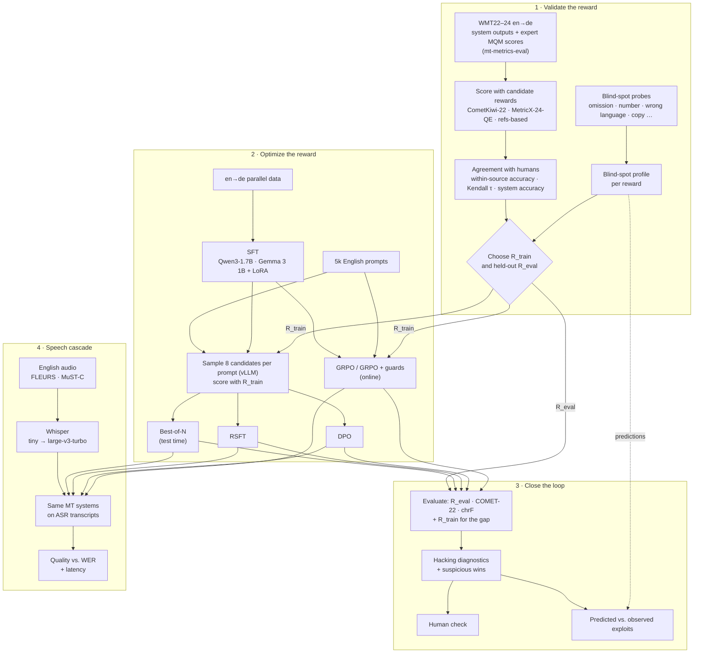
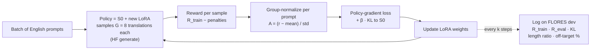

# System Workflow

This document explains how the system works end to end: what each component takes in, what it does, what it produces, and why it is built that way. The *why this project* and the plan are in [`proposal.md`](proposal.md).

> If you prefer an example first, start with **§8, the walkthrough**, which follows one sentence through the whole system.

---

## 1. The big picture



The project contains **three benchmarks**, and each feeds the next:

| Benchmark | Compares | Main output |
|---|---|---|
| **A · Rewards** (Phase 1) | Candidate reward models vs. expert judgements | Which reward to train on, and its blind spots |
| **B · Alignment methods** (Phases 2–3) | Best-of-N, RSFT, DPO, GRPO (+ guards), from the same start with the same budget | Which method uses the reward best, and how much it games it |
| **C · Speech robustness** (Phase 4) | The same MT systems on gold vs. Whisper transcripts | How quality degrades with ASR error rate, and at what latency |

---

## 2. The idea that connects the phases: within-source comparisons

All four alignment methods consume the reward the same way: **they only compare translations of the same source sentence.**

| Method | What it does with the reward |
|---|---|
| Best-of-N | Takes the `argmax` over N candidates *for one source* |
| RSFT | Keeps the best candidate *for each source* |
| DPO | Uses a (better, worse) pair *for the same source* |
| GRPO | Subtracts the group mean *for that source* (the advantage) |

A reward could have excellent global correlation with humans, because it knows which *sentences* are hard, and still be poor at telling apart two translations of the same sentence. Phase 1 therefore reports **within-source pairwise accuracy** as its primary statistic: the share of same-source translation pairs on which the reward and the MQM annotators agree on which translation is better.

---

## 3. Shared building blocks

### 3.1 One reward interface for every phase

```python
class Reward(Protocol):
    name: str
    needs_reference: bool
    def score(self, sources: list[str], hypotheses: list[str],
              references: list[str] | None = None) -> list[float]:
        """Higher is better. MetricX error scores (0–25, lower is better) are negated."""
```

The same object is used in the Phase 1 meta-evaluation, in the Phase 2 pair building and GRPO reward, and in the Phase 3 evaluation. **The reward studied in Phase 1 is therefore exactly the reward optimized in Phase 2**, with the same model, preprocessing and batching.

Implementations:
- `CometKiwi22` uses `unbabel-comet` with `Unbabel/wmt22-cometkiwi-da`, a gated model.
- `MetricX24` uses Google's `metricx` inference code with `google/metricx-24-hybrid-large-v2p6`, in QE or reference mode.
- `Comet22`, `ChrF` and `Bleu` are the reference-based comparisons.
- `Penalties` and `Composite` add the guard terms (§5.7).

### 3.2 Prompt template and generation
- A fixed chat-format template: *"Translate the following English text into German. Output only the translation."* followed by the source. The same template is used for every Qwen-based system.
- Generation runs in **vLLM** for sampling and evaluation. Evaluation decoding is greedy, except for best-of-N and MBR.
- Output post-processing strips quotes, labels such as "German:" and trailing explanations. The rate at which this cleanup fires is logged, because it can hide problems.

### 3.3 Data splits (leakage control)

| Data | Used for | Never used for |
|---|---|---|
| WMT22–23 en→de outputs + MQM (mt-metrics-eval) | Phase 1 meta-evaluation and reward choice | Training, final testing |
| WMT24 en→de outputs + MQM | Phase 1, reported separately as a check on LLM-era systems | Reward choice, training |
| Probe set (built from WMT22 references) | Phase 1 blind-spot probes | Training |
| WMT en-de parallel data (News Commentary, Europarl) | SFT | Evaluation |
| Prompt pool: 5k English sentences from News Crawl, deduplicated against all test sets | RSFT, DPO, GRPO | Evaluation |
| FLORES-200 **dev** | Checkpoint selection, over-optimization curves | Final numbers |
| FLORES-200 **devtest** en→de | **Primary final test** | Any selection or tuning |
| WMT24 en→de (sources, references) | Secondary final test | Training, checkpoint selection |
| FLORES devtest de→en, en→zh | Forgetting check | Training |
| FLEURS en test, MuST-C tst-COMMON | Speech tests | Training |
| ASR-corpus utterances (e.g. LibriSpeech) | Noise-aware GRPO (stretch) | Evaluation |

> FLEURS sentences come from FLORES dev and devtest. FLEURS is therefore *not* used for noise-aware training, and MuST-C serves as the fully independent speech test.

---

## 4. Phase 1: Validate the reward

### 4.1 Meta-evaluation against expert judgements

**Input.** For WMT22 and WMT23 en→de, `mt-metrics-eval` provides the source segments, the references, every submitted system's outputs, and the expert **MQM** score for each (system, segment). MQM scores are error-weighted: annotators mark error spans with a category and a severity. WMT23 en→de was annotated at paragraph level, so the project uses mt-metrics-eval's sentence-split version (`wmt23.sent`) to match its sentence-level setup. Outlier systems and human translations are excluded, so only MT outputs are compared. WMT24 en→de, the newest set with expert scores, is scored too: its systems are mostly LLM-based, closer to what our policy will produce. It is paragraph-level, so it is reported in its own column as a check and is not pooled into the numbers that decide the reward choice.

**Process.**
1. Score every (source, system output) with each candidate reward. This is inference only and runs on a free T4.
2. Compute the agreement with MQM:
   - **within-source pairwise accuracy** (primary): for every source, look at all pairs of system outputs and count how often the reward orders each pair the same way as MQM, handling ties. Average over sources. This is the "item-grouped" view.
   - **segment-level Kendall τ** and **tie-calibrated pairwise accuracy** (*acc_eq*), the standard WMT meta-evaluation statistics;
   - **system-level pairwise accuracy**: does the reward rank whole systems correctly?
3. Bootstrap the confidence intervals, and run permutation tests for "reward X is better than reward Y".
4. **Sanity checks**, before trusting the numbers:
   - our CometKiwi, COMET-22 and chrF scores must reproduce the scores that ship with the WMT23 data for the same public models (Pearson ≈ 1);
   - our tie-calibrated accuracy is recomputed with mt-metrics-eval's own implementation and must match exactly.

**Output.** Benchmark A: rewards × statistics, with CIs, plus throughput (segments per second) and memory for each reward on a 24 GB GPU.

### 4.2 Blind-spot probes

**Input.** About 500 high-quality en→de pairs (WMT22 references).

**Process.** For each pair, create controlled perturbations of the good translation. Most are rule-based, the omission and addition variants are generated with an LLM, and a sample is spot-checked by hand.

| Probe | Example of the change |
|---|---|
| Omission | Drop a clause or a prepositional phrase |
| Addition | Append a plausible but unsupported phrase |
| Number | `12 %` → `21 %`; change dates and amounts |
| Named entity | Swap a person or place name |
| Negation | Remove or add *nicht* / *kein* |
| Untranslated | Return the English source unchanged |
| Wrong language | Translate into another language |
| Word order | Scramble words within a clause (fluency damage only) |
| Repetition | Duplicate a phrase |
| Formality | *Sie* ↔ *du* (a sensitivity probe, not always an error) |

For each reward and category, measure the **detection rate**, the share of cases with `reward(good) > reward(perturbed)`, and the mean score drop.

**Output.** A **blind-spot profile**: a reward × category heatmap. These are the *predictions* for Phase 3: a category with a low detection rate is a likely exploit.

### 4.3 Choosing R_train and R_eval

Decision rule, written down before seeing any Phase 2 results:

1. **R_train** is the reference-free (QE) candidate with the highest within-source accuracy, pooled over WMT22 + WMT23. Ties are broken by blind-spot coverage, then by cost; it must fit inside GRPO on 24 GB.
2. **R_eval** is the strongest available metric **from a different model family** than R_train, used *with references*. The default expectation is R_train = CometKiwi-22 and R_eval = MetricX-24 with references, but the data decides.
3. COMET-22 stays as a secondary evaluator. It is marked "same family" whenever R_train is a COMET model.

---

## 5. Phase 2: Optimize the reward

### 5.1 SFT (shared starting point)

- **Data:** 20k en→de pairs from News Commentary (news domain, like WMT), filtered with heuristics only: language ID, length ratio, 5–60 words, deduplication, and removal of anything that occurs in a test set. Without QE filtering, the baseline isn't already tuned towards R_train or R_eval. The 5,000 RL prompts are English sentences from the same corpus, disjoint from the SFT pairs.
- **Training:** TRL `SFTTrainer`, LoRA on all linear layers, loss on target tokens only, 1–2 epochs.
- **After training:** merge the LoRA adapter into the base weights. The merged model is **S0**, both the starting point and the frozen reference policy for every method below.

### 5.2 Candidate sampling and scoring (shared by best-of-N, RSFT and DPO)

- **One sampling setting for every sampling-based method** (candidates, best-of-N, GRPO) and both models, chosen by a pilot (`scripts/p2_sampling_pilot.py`):
  - **Data:** 200 held-out sentences (the SFT validation set), with temperature {0.6, 0.8, 1.0} × top-p {0.95, 1.0} and 8 samples each, scored with R_train.
  - **Why a pilot:** the setting trades *diversity* against *quality*. The methods learn from differences between samples of the same source, but broken samples waste the reward budget and make DPO pairs trivially easy. Vendor defaults differ between models and target chat use.
  - **Rule, fixed in advance:** among settings with ≤ 5% broken samples (MetricX error > 10), take the largest mean within-group reward spread. Near-ties go to top-p = 1.0, which keeps GRPO exactly on-policy, because TRL accounts for the temperature in its log-probabilities but not for top-p.
  - **Where the choice lives:** `results/p2/sampling.json`, which every script reads. Samples drawn with different settings are never mixed, and RSFT/DPO adapters record which samples they were trained on.
  - **Why it was added:** the first run sampled at temperature 1.0 without top-p. About 25% of the samples were broken, and the DPO pairs became mostly "good vs. gibberish".
- For each of the 5k pool prompts, sample N = 8 translations from S0 with that setting.
- Score all 40k candidates with R_train and store them as JSONL with the scores attached.
- This file is the **matched reward budget** (40k reward calls). GRPO gets the same 40k through its own online sampling.

### 5.3 Best-of-N (inference-time alignment)

- At test time, sample N candidates from S0 and return the one R_train scores highest.
- There is no training, but every request costs N generations plus N reward calls.
- Also run with N ∈ {1, 2, 4, 8, 16} on FLORES dev. This gives the cheapest over-optimization curve: watch R_train rise with N while R_eval flattens or falls.

### 5.4 RSFT (rejection-sampling fine-tuning)

- Keep the top-scoring candidate for each prompt, and optionally only if it clears a score threshold.
- Continue LoRA fine-tuning from S0 on these self-generated targets.
- This is the simplest way to put best-of-N quality into the weights (cf. RAFT and ReST), at single-sample inference cost.

### 5.5 DPO (offline preference optimization)

- **Pairs:** for each prompt, chosen = best candidate and rejected = worst candidate. Keep the pair only if the score margin exceeds a threshold, because tiny margins are mostly noise.
- **Loss** (TRL `DPOTrainer`, reference = S0, β ≈ 0.1 as a starting point):

$$\mathcal{L}_\text{DPO} = -\log\sigma\Big(\beta\big[\log\tfrac{\pi_\theta(y_w\mid x)}{\pi_\text{ref}(y_w\mid x)} - \log\tfrac{\pi_\theta(y_l\mid x)}{\pi_\text{ref}(y_l\mid x)}\big]\Big)$$

- It only needs the *ordering* within each pair, which is again a within-source comparison.
- **Watch:** output length drift, and both the chosen and rejected log-probabilities falling together.

### 5.6 GRPO (online RL)



- For each prompt, the policy samples a **group** of G translations. Each one is scored, and its **advantage** is its reward relative to the group:

$$A_i = \frac{r_i - \operatorname{mean}(r_1,\dots,r_G)}{\operatorname{std}(r_1,\dots,r_G)}$$

  Translations better than their siblings are reinforced and worse ones are suppressed. No value network is needed, which saves memory on one GPU.
- A **KL penalty** (coefficient β) keeps the policy close to S0. β is set explicitly and swept (e.g. 0, 0.01, 0.05) rather than left at a library default.
- **Single-GPU setup:** TRL `GRPOTrainer` with HF generation (vLLM optional later). The policy is a 1–2B model with LoRA, and R_train runs on the same card. The two GRPO runs of a model use the two T4s side by side. Max completion length is 160 tokens, G = 8 (4 if memory is tight), and gradient checkpointing is on.
- **Budget:** the matched-budget checkpoint is taken at 40k sampled translations: step 625, with 8 prompts × 8 samples per step. Training continues to step 1250 *only* to trace the over-optimization curve, and adapters are exported every 125 steps. Any other checkpoint choice is made by R_eval on FLORES dev, never by R_train.
- **Guards in both runs:** the four checks (wrong language, number mismatch, length ratio, copy) are reward functions in both GRPO runs. Plain GRPO gives them weight 0, so their rates are only logged. Guarded GRPO charges 5 MetricX points per violation. A sample of completions with scores and flags is written every 25 steps for the Phase 3 audit.

### 5.7 Guards (hacking mitigation, system A5)

The composite reward is

`r = R_train − λ_lang·[wrong language] − λ_len·[length ratio outside the training-data range] − λ_copy·[mostly copied from source]`

combined with the KL sweep.

*Expectation to test:* rule-based guards catch crude exploits (copying, wrong language) but not subtle ones (omissions, number errors). The subtle ones need a better reward, which is the link back to Phase 1.

---

## 6. Phase 3: Close the loop

### 6.1 Evaluation suite (every system, every test set)

| Metric | Type | Role |
|---|---|---|
| **R_eval** | Learned, with references, different family | **Primary**, held out |
| COMET-22 | Learned, with references | Secondary |
| chrF, BLEU (sacreBLEU) | Surface overlap | Sanity check |
| R_train | Learned, QE | Shown only to measure the **over-optimization gap** |
| Exploit rates | Rule-based diagnostics (§6.3) | Hacking |
| Inference cost | Generations and reward calls per request | Deployment trade-off |

Differences between systems come with paired-bootstrap 95% CIs.

### 6.2 Over-optimization curves
- **Best-of-N:** R_train and R_eval against N.
- **GRPO:** R_train and R_eval against training step and against KL to S0, one curve per β.

If R_train keeps rising while R_eval peaks and then drops, the curve itself shows the reward being gamed.

### 6.3 Hacking diagnostics (cheap, rule-based, run on every output)
- **Off-target language rate:** language ID on the output.
- **Length-ratio distribution:** output length relative to the source, compared with the references.
- **Source-copy rate:** character n-gram overlap with the source.
- **Number mismatch rate:** digits in the source that are missing or changed in the output.
- **Repetition rate:** repeated n-grams.
- **Omission proxy:** low cross-lingual similarity (e.g. LaBSE) combined with a short length ratio.

### 6.4 Suspicious wins and predicted vs. observed exploits
1. Find segments where **R_train(RL) − R_train(SFT) is large but R_eval(RL) < R_eval(SFT)**: the reward says better, the held-out metric says worse.
2. Sample about 50 of them and label each with the probe categories from §4.2.
3. Build the **predicted vs. observed** table: for each category, the Phase 1 detection rate of R_train next to its frequency among suspicious wins. If the low-detection categories dominate the suspicious wins, Phase 1 predicted the exploits, which confirms H3.

### 6.5 Human check
- **A/B (unbiased win rate):** 60 random FLORES devtest segments. SFT and the best RL output are shown side by side in random order, with the source and reference visible. The annotator marks a preference (or a tie) and any major errors.
- **Error audit:** the 50 suspicious-win segments from §6.4, labelled by error category.
- **Agreement:** a native German speaker labels 30 of the A/B segments, and the report gives the agreement.
- Guidelines and blinded sheets are kept in `human_eval/`.

### 6.6 Forgetting check
Evaluate S0 and every aligned system on FLORES devtest **de→en** (the reverse direction) and **en→zh** (an unrelated pair). Report chrF, COMET-22 and off-target rate. A drop shows that alignment on en→de damaged other abilities.

---

## 7. Phase 4: Cascaded speech translation

### 7.1 ASR
- Run Whisper tiny, base, small, medium and large-v3-turbo on the English audio of the test sets. Each set is transcribed once per model and cached.
- **WER** is computed with `jiwer` after Whisper's English text normalizer, so casing and punctuation don't count as errors. The *MT* input is the raw Whisper output, with its casing and punctuation.
- The five model sizes give a natural range of WER, so each test set has 6 input conditions: gold plus 5 ASR levels.

### 7.2 Cascade evaluation
- Each MT system (S0, A1–A5 and the anchors) translates the gold transcript and every ASR transcript.
- Translation quality is scored against the **gold German reference**. For QE metrics the source is the **gold English transcript**, because the ASR transcript may itself be wrong.
- Test sets:
  - **FLEURS** English test: read speech, German reference from the parallel FLORES sentence.
  - **MuST-C tst-COMMON** en→de: TED talks, closer to spontaneous speech.

  Both use the gold segmentation.

### 7.3 Robustness analysis
- **Gap:** quality(gold) − quality(Whisper-*x*) for each MT system.
- **Slope:** quality against WER across the five Whisper sizes, one line per MT system. A flatter line means a more robust system.
- **Error types:** which ASR errors break translation (homophones, named entities, numbers, missing punctuation), sampled and categorized.

### 7.4 Latency
- At batch size 1 on the same GPU, measure ASR time and MT time per utterance, and report the median, the p90 and the real-time factor.
- Best-of-N is shown separately because it multiplies MT latency.

**Takeaway to quantify:** training-time alignment (RSFT, DPO, GRPO) puts quality into the weights at *zero* extra inference cost, while best-of-N pays on every request.

### 7.5 Noise-aware GRPO (stretch)
- Prompts are Whisper-small transcripts of English utterances from an ASR corpus that does not overlap any test set.
- **Ablation, "which source should the reward see?":**
  - **(a) The ASR transcript.** The model is rewarded for faithfully translating what it was given.
  - **(b) The gold transcript.** The model is rewarded for translating what was *meant*. This can teach it to repair recognizable errors, but it can also reward guessing, which is hallucination.
- Compare the robustness slopes from §7.3 for both variants.

---

## 8. End-to-end walkthrough: one sentence through the system

> All scores below are **illustrative**. They show how the parts interact; they are not results.

**Source:** *"The company reported a 12% rise in profits in the third quarter."*

**① Phase 1 has already measured** that R_train (say CometKiwi) detects omissions in only ~70% of probe cases and number changes in ~80%, but detects untranslated output almost always.

**② Sampling.** S0 produces a group of four candidates (G = 4 to keep the example short):

| # | Candidate | What's wrong | R_train ↑ | R_eval ↓ (MetricX) |
|---|---|---|---|---|
| c1 | Das Unternehmen meldete im dritten Quartal einen Gewinnanstieg von 12 %. | nothing | 0.84 | 1.2 |
| c2 | Das Unternehmen meldete einen Gewinnanstieg von 12 %. | **omits** "in the third quarter" | **0.86** | 4.5 |
| c3 | Das Unternehmen meldete im dritten Quartal einen Gewinnanstieg von 21 %. | **wrong number** | 0.80 | 5.0 |
| c4 | The company reported a 12% rise in profits in the third quarter. | untranslated | 0.45 | 20.0 |

**③ How each method uses these scores:**
- **Best-of-N** returns **c2**. The omission wins, because it sits in R_train's blind spot.
- **RSFT** fine-tunes on **c2**.
- **DPO** takes the pair (chosen c2, rejected c4). It learns "translate rather than copy", which is good, but it also nudges the policy towards the omission.
- **GRPO** computes advantages ≈ (+0.53, **+0.64**, +0.32, −1.49). Copying is strongly suppressed. The omission is reinforced *most*, and even the number error gets a positive push.

**④ Over thousands of prompts,** a systematic blind spot becomes a systematic behaviour. On FLORES dev, R_train keeps rising, the length ratio shrinks, and R_eval stalls and then falls.

**⑤ Closing the loop.** The diagnostics flag shorter outputs and rising omission-proxy rates. The suspicious-win audit finds mostly omissions and number errors, the same categories with low detection rates in Phase 1. The guards from §5.7 remove copying, already rare, but not the omissions, so the next step is a better reward.

**⑥ Speech.** The same sentence is spoken and transcribed by Whisper-tiny as *"…a 12% rise in **prophets** in the third quarter."* A brittle MT system translates "Propheten"; a robust one infers "Gewinne" from context. Comparing SFT and the RL systems on many such cases, at five WER levels, gives the robustness curves in §7.3.

---

## 9. Pipeline steps and artifacts (target interface)

| Step | Command | Produces |
|---|---|---|
| 1a | `python scripts/p1_build_inputs.py --run runs/p1 --download` | `segments.jsonl` (rated translations), `probes.jsonl` |
| 1b | `python scripts/p1_score.py --run runs/p1 --rewards chrf bleu cometkiwi22 comet22 metricx24_qe metricx24_ref` | `scores/<reward>.jsonl` and timing |
| 1c | `python scripts/p1_analyze.py --run runs/p1` | `report/summary.md`, `reward_benchmark.csv`, `blind_spots.csv/.png` |
| 2a | `python scripts/p2_prepare_data.py --out data/p2` | `sft_train.jsonl`, `prompts.jsonl`, `testsets/*.jsonl` |
| 2b | `python scripts/p2_train.py --config configs/p2/sft.yaml` | `ckpt/sft` (S0) |
| 2c | `python scripts/p2_sample.py --system sft --n 8 --reward metricx24_qe`, then `python scripts/p2_build_pairs.py` | `candidates.jsonl`, `rsft.jsonl`, `dpo_pairs.jsonl` |
| 2d | `python scripts/p2_train.py --config configs/p2/{rsft,dpo,grpo,grpo_guarded}.yaml` | `ckpt/{rsft,dpo,grpo,grpo_guarded}`, `ckpt/grpo-step<k>` |
| 2e | `python scripts/p2_translate.py --systems … [--best-of 8]` | `results/p2/outputs/<system>/<testset>.jsonl`, `quick_eval.md` |
| all of 2 | `python scripts/p2_run.py` (what the Kaggle notebook runs) | the next block of work from `configs/p2/run.yaml`, skipping what is saved |
| 3a | `python scripts/p3_evaluate.py --systems all --testsets flores_devtest wmt24` | `reports/p3/method_benchmark.csv` |
| 3b | `python scripts/p3_hacking_report.py` | `reports/p3/exploits.md`, over-optimization plots |
| 4a | `python scripts/p4_transcribe.py --whisper tiny base small medium large-v3-turbo --testsets fleurs_en mustc_tst_common` | `data/asr/*.jsonl`, WER table |
| 4b | `python scripts/p4_cascade_eval.py --systems all` | `reports/p4/robustness.csv`, latency table, curves |

Every step reads a YAML config, writes its outputs to a versioned folder, and logs to Weights & Biases (or CSV). Any reported number can therefore be traced back to one command and one config.
