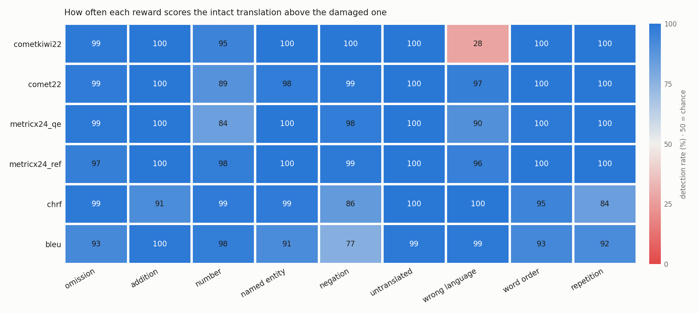

# Phase 1 results · reward benchmark (English→German)

Data: wmt22: 17095 translations of 1315 source segments by 14 systems (MQM); wmt23.sent: 14049 translations of 1561 source segments by 9 systems (MQM); wmt24: 7792 translations of 487 source segments by 25 systems (MQM)

## A · Agreement with expert judgements

*Within-source accuracy*: of all pairs of translations of the **same source** where the experts preferred one, the share the reward ranks the same way (50% = chance). This is how best-of-N, DPO and GRPO use a reward. 95% bootstrap CIs over source segments.

The headline number and the reward choice use wmt22 + wmt23.sent. wmt24 is reported in its own column as a check on newer, LLM-era systems (paragraph-level segments, so very long inputs are truncated by CometKiwi), and does not influence the choice.

| Reward | Needs ref | Within-source acc. (wmt22 + wmt23.sent) | Within-source wmt22 | Within-source wmt23.sent | Within-source wmt24 | acc_eq (wmt22 / wmt23.sent / wmt24) | Kendall τ_b (wmt22 / wmt23.sent / wmt24) | System acc. (wmt22 / wmt23.sent / wmt24) | Speed (inputs/s) |
|---|---|---|---|---|---|---|---|---|---|
| metricx24_ref | yes | 68% [67, 69] | 68% | 67% | 65% | 0.614 / 0.572 / 0.520 | 0.418 / 0.359 / 0.298 | 0.85 / 0.92 / 0.90 | 28.3 |
| **comet22** | yes | 66% [65, 67] | 66% | 67% | 67% | 0.582 / 0.548 / 0.491 | 0.343 / 0.339 / 0.267 | 0.78 / 0.97 / 0.90 | 35.7 |
| **metricx24_qe** | no | 64% [63, 65] | 64% | 64% | 61% | 0.602 / 0.555 / 0.495 | 0.380 / 0.303 / 0.255 | 0.81 / 0.89 / 0.84 | 44.1 |
| cometkiwi22 | no | 62% [61, 62] | 59% | 65% | 59% | 0.573 / 0.555 / 0.477 | 0.231 / 0.285 / 0.184 | 0.65 / 0.83 / 0.78 | 58.1 |
| chrf | yes | 60% [59, 61] | 61% | 60% | 59% | 0.541 / 0.473 / 0.432 | 0.214 / 0.156 / 0.121 | 0.74 / 0.78 / 0.79 | 2399.3 |
| bleu | yes | 60% [59, 61] | 60% | 60% | 58% | 0.540 / 0.473 / 0.432 | 0.169 / 0.146 / 0.129 | 0.68 / 0.78 / 0.77 | 6744.4 |

Speed measured on Tesla T4.

### Pairwise differences (pooled within-source accuracy, paired bootstrap)

| A | B | A − B (points) | 95% CI | p |
|---|---|---|---|---|
| cometkiwi22 | comet22 | -4.8 | [-5.8, -3.8] | 0.000 |
| cometkiwi22 | metricx24_qe | -2.2 | [-3.4, -1.2] | 0.000 |
| cometkiwi22 | metricx24_ref | -6.4 | [-7.4, -5.3] | 0.000 |
| cometkiwi22 | chrf | +1.3 | [+0.1, +2.5] | 0.028 |
| cometkiwi22 | bleu | +1.7 | [+0.5, +3.0] | 0.008 |
| comet22 | metricx24_qe | +2.5 | [+1.5, +3.6] | 0.000 |
| comet22 | metricx24_ref | -1.6 | [-2.5, -0.7] | 0.000 |
| comet22 | chrf | +6.1 | [+5.3, +6.8] | 0.000 |
| comet22 | bleu | +6.5 | [+5.6, +7.4] | 0.000 |
| metricx24_qe | metricx24_ref | -4.2 | [-4.9, -3.4] | 0.000 |
| metricx24_qe | chrf | +3.5 | [+2.4, +4.7] | 0.000 |
| metricx24_qe | bleu | +4.0 | [+2.9, +5.2] | 0.000 |
| metricx24_ref | chrf | +7.7 | [+6.8, +8.7] | 0.000 |
| metricx24_ref | bleu | +8.1 | [+7.1, +9.1] | 0.000 |
| chrf | bleu | +0.4 | [-0.2, +1.1] | 0.166 |

## B · Blind spots

Detection rate (%): how often the reward scores the intact translation above a damaged copy. 50 = chance; below 50 = the reward *prefers* the damaged version. Low values are the predicted exploits for RL.

| Reward | omission (n=344) | addition (n=500) | number (n=82) | named entity (n=152) | negation (n=91) | untranslated (n=500) | wrong language (n=500) | word order (n=497) | repetition (n=497) |
|---|---|---|---|---|---|---|---|---|---|
| metricx24_ref | 97 | 100 | 98 | 100 | 99 | 100 | 96 | 100 | 100 |
| comet22 | 99 | 100 | 89 | 98 | 99 | 100 | 97 | 100 | 100 |
| metricx24_qe | 99 | 100 | 84 | 100 | 98 | 100 | 90 | 100 | 100 |
| cometkiwi22 | 99 | 100 | 95 | 100 | 100 | 100 | 28 | 100 | 100 |
| chrf | 99 | 91 | 99 | 99 | 86 | 100 | 100 | 95 | 84 |
| bleu | 93 | 100 | 98 | 91 | 77 | 99 | 99 | 93 | 92 |

## C · Sanity checks

Our scores vs. the scores stored with the WMT data (✅ = same public model, should correlate ≈ 1):

| Reward | Test set | Stored metric | n | Pearson | max abs diff | Status |
|---|---|---|---|---|---|---|
| cometkiwi22 | wmt22 | COMETKiwi-src | 17095 | 0.7534 | 2.2065 | info |
| cometkiwi22 | wmt24 | CometKiwi-src | 7792 | 0.9987 | 0.0772 | ✅ |
| comet22 | wmt22 | COMET-22-refA | 17095 | 0.7789 | 2.3841 | info |
| comet22 | wmt24 | COMET-22-refB | 7792 | 1.0000 | 0.0080 | ✅ |
| chrf | wmt22 | chrF-refA | 17095 | 1.0000 | 0.0000 | ✅ |
| chrf | wmt24 | chrF-refB | 7792 | 1.0000 | 0.0000 | ✅ |
| bleu | wmt22 | BLEU-refA | 17095 | 1.0000 | 0.0000 | info |
| bleu | wmt24 | BLEU-refB | 7792 | 1.0000 | 0.0000 | info |
| metricx24_qe | wmt24 | MetricX-24-Hybrid-QE-src | 7792 | 0.7212 | 13.0381 | info |
| metricx24_ref | wmt24 | MetricX-24-Hybrid-refB | 7792 | 0.7491 | 13.5148 | info |

acc_eq recomputed with mt-metrics-eval's own implementation: max difference 1.52e-13 over 18 reward × test-set cells (✅ identical).

### Context: stored WMT metric scores (not run here)

Within-source accuracy of metrics whose scores ship with the WMT data, including larger models that are too expensive to run as an RL reward on one GPU:

| Stored metric | wmt22 | wmt23.sent | wmt24 |
|---|---|---|---|
| BLEU-refA | 60% | – | – |
| BLEU-refB | – | – | 58% |
| BLEURT-20-refA | 66% | – | – |
| BLEURT-20-refB | – | – | 67% |
| COMET-22-refA | 67% | – | – |
| COMET-22-refB | – | – | 67% |
| COMETKiwi-src | 63% | – | – |
| CometKiwi-src | – | – | 59% |
| MetricX-24-Hybrid-QE-src | – | – | 66% |
| MetricX-24-Hybrid-refB | – | – | 68% |
| XCOMET-QE-src | – | – | 65% |
| XCOMET-refB | – | – | 68% |
| chrF-refA | 61% | – | – |
| chrF-refB | – | – | 59% |

## D · Suggested choice (rule from docs/workflow.md §4.3)

- **R_train (training reward): `metricx24_qe`**
- **R_eval (held-out evaluator): `comet22`**
- metricx24_qe beats cometkiwi22 on within-source accuracy by 2.2 points (95% CI [1.2, 3.4]).
