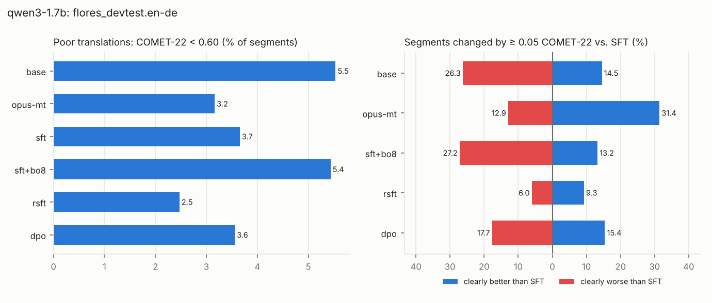

# Phase 3 results · held-out evaluation, over-optimization and exploits

Training reward: MetricX-24-QE. Held-out evaluator: COMET-22. Generated by `scripts/p3_analyze.py` from the v1 outputs; sections appear as their inputs exist.

## qwen3-1.7b

### A · Methods vs. SFT on flores_devtest.en-de (1012 segments)

COMET-22 never guided training (held out); MetricX-QE is the training reward. Δ = paired mean difference to `sft` with a 95% bootstrap CI (* = p < 0.05). *Gap* = training-reward gain minus held-out gain, both in units of SFT's segment SD: positive means the training reward improved more than held-out quality (over-optimization).

| System | COMET-22 ↑ (held out) | Δ vs SFT | MetricX-QE ↑ (trained on) | Δ vs SFT | Gap (SD) | chrF | BLEU | Inference cost |
|---|---|---|---|---|---|---|---|---|
| base | 0.805 | -0.017 [-0.023, -0.013] * | -1.61 | -0.20 [-0.29, -0.11] * | +0.06 | 53.4 | 22.9 | 1× |
| opus-mt | 0.847 | +0.025 [+0.019, +0.031] * | -1.28 | +0.13 [+0.03, +0.23] * | -0.19 | 63.6 | 36.1 | 1× |
| sft | 0.822 | – | -1.41 | – | – | 54.2 | 24.5 | 1× |
| sft+bo8 | 0.805 | -0.018 [-0.022, -0.013] * | -0.89 | +0.53 [+0.46, +0.59] * | +0.54 | 50.0 | 18.6 | 8 samples + 8 reward calls |
| rsft | 0.828 | +0.005 [+0.002, +0.008] * | -1.33 | +0.08 [+0.04, +0.13] * | -0.00 | 54.4 | 24.6 | 1× |
| dpo | 0.820 | -0.003 [-0.008, +0.002] | -1.35 | +0.07 [-0.02, +0.15] | +0.07 | 56.7 | 25.5 | 1× |

wmt24.en-de (paragraph-level): base 0.734 (-0.016 [-0.022, -0.010] *); opus-mt 0.733 (-0.017 [-0.025, -0.007] *); sft 0.750; sft+bo8 0.711 (-0.039 [-0.046, -0.034] *); rsft 0.756 (+0.006 [+0.003, +0.010] *); dpo 0.740 (-0.010 [-0.016, -0.005] *).

### A2 · Beyond the average: the tails on flores_devtest.en-de

Mean differences hide where a method helps or hurts. Bands of COMET-22 per segment (% of segments), the mean of the worst 10% of segments, and the share of segments that are clearly (≥ 0.05) better or worse than SFT on the same sentence.

| System | poor % | weak % | fine % | very good % | Worst 10% mean | Better than SFT % | Worse than SFT % |
|---|---|---|---|---|---|---|---|
| base | 5.5 | 8.9 | 45.0 | 40.6 | 0.584 | 14.5 | 26.3 |
| opus-mt | 3.2 | 5.7 | 27.5 | 63.6 | 0.621 | 31.4 | 12.9 |
| sft | 3.7 | 6.9 | 41.6 | 47.8 | 0.616 | – | – |
| sft+bo8 | 5.4 | 10.5 | 44.5 | 39.6 | 0.588 | 13.2 | 27.2 |
| rsft | 2.5 | 7.0 | 40.5 | 50.0 | 0.634 | 9.3 | 6.0 |
| dpo | 3.6 | 7.9 | 40.2 | 48.3 | 0.614 | 15.4 | 17.7 |

Largest drops from SFT (all 20 per system in `<model>_worst_regressions_<system>.jsonl`):

> **sft+bo8**, COMET-22 -0.384, MetricX-QE +0.5 (other)  
> SRC It is Martelly's fifth CEP in four years.  
> SFT Es ist Martellys fünfte CEP in vier Jahren.  
> SFT+BO8 Martelly hat sich in diesem Jahr bereits fünfmals im CEP vertreten.

> **rsft**, COMET-22 -0.623, MetricX-QE -7.3 (wrong_language, long, repetition)  
> SRC As one example, American citizens in the Middle East might face different situations from Europeans or Arabs.  
> SFT Als Beispiel: Amerikaner im Nahen Osten könnten sich in Situationen befinden, die anders als Europäer oder Araber sind.  
> RSFT Als Beispiel: Amerikaner im Nahen Osten könnten sich in Situationen befinden, die anders als in Europa oder im Nahen Osten anders als in Europa anders als in Europa anders als in E

> **dpo**, COMET-22 -0.393, MetricX-QE -3.7 (other)  
> SRC For the Springboks, it ended a five-match losing streak.  
> SFT Für die Springboks endete es damit, dass sie eine fünf-match-Verlustreihe beendet hatten.  
> DPO Für die Springboks endete dies ein fünf-match lassendes Straffeld.

### B · Over-optimization

Best-of-k on FLORES dev (chosen by the training reward): k=1: MetricX-QE -3.04 / COMET-22 0.720, k=2: MetricX-QE -1.76 / COMET-22 0.759, k=4: MetricX-QE -1.13 / COMET-22 0.790, k=8: MetricX-QE -0.83 / COMET-22 0.810.

### C · Exploits

Share of outputs with each signal (%). *short* / *long* = under 70% / over 140% of the reference length (omission / addition proxies).

| System | wrong_language | number_mismatch | short | long | copy | repetition |
|---|---|---|---|---|---|---|
| base | 0.1 | 0.7 | 1.1 | 0.7 | 0.0 | 0.1 |
| opus-mt | 0.1 | 1.4 | 0.6 | 0.3 | 0.1 | 0.0 |
| sft | 0.0 | 1.4 | 2.1 | 1.1 | 0.0 | 0.0 |
| sft+bo8 | 0.0 | 1.7 | 0.4 | 1.5 | 0.0 | 0.0 |
| rsft | 0.1 | 1.5 | 1.8 | 0.6 | 0.0 | 0.1 |
| dpo | 0.0 | 1.3 | 0.1 | 2.0 | 0.0 | 0.0 |

**Suspicious wins** (training reward ≥ 1 point better than SFT, COMET-22 ≥ 0.02 worse), with the signals the RL output introduced:

- sft+bo8: 63 of 1012 segments — other 59, number_mismatch 2, long 2
- rsft: 6 of 1012 segments — other 6
- dpo: 23 of 1012 segments — other 22, long 1

### F · Forgetting on untrained directions

RSFT, DPO and GRPO train on English→German only; SFT (v2) also on German→English, so German→English measures forgetting of a trained direction and English→Chinese an untrained one. *Wrong language* = the output is not in the target language; *near copy* = most character 4-grams of the output occur in the source (includes rewrites of the source in its own language); *exact copy* = the output is the source, verbatim.

| Test set | System | COMET-22 | chrF | BLEU | Wrong language % | Near copy % | Exact copy % |
|---|---|---|---|---|---|---|---|
| flores_devtest.de-en | base | 0.877 | 64.0 | 37.2 | 0.3 | 0.3 | 0.0 |
| flores_devtest.de-en | sft | 0.751 | 25.1 | 2.6 | 98.9 | 96.7 | 41.5 |
| flores_devtest.de-en | rsft | 0.750 | 24.9 | 2.4 | 99.3 | 96.7 | 35.3 |
| flores_devtest.de-en | dpo | 0.739 | 24.7 | 2.3 | 100.0 | 94.6 | 13.1 |
| flores_devtest.en-zh | base | 0.872 | 33.2 | 38.5 | 0.2 | 0.1 | 0.0 |
| flores_devtest.en-zh | sft | 0.858 | 31.9 | 36.0 | 3.8 | 2.2 | 1.2 |
| flores_devtest.en-zh | rsft | 0.861 | 32.4 | 36.4 | 3.3 | 1.6 | 0.9 |
| flores_devtest.en-zh | dpo | 0.866 | 34.0 | 38.3 | 0.7 | 0.1 | 0.0 |
