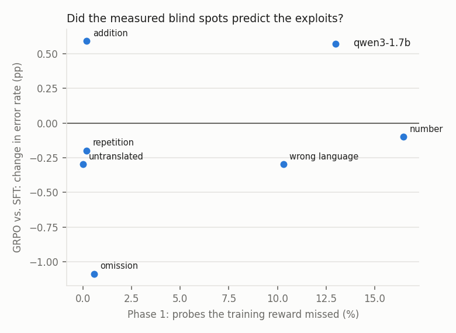
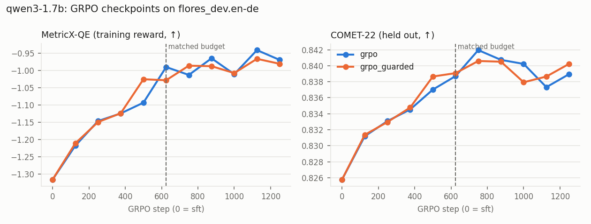
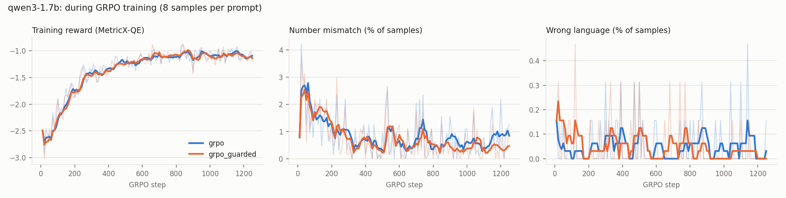

# Phase 3 results · held-out evaluation, over-optimization and exploits

Training reward: MetricX-24-QE. Held-out evaluator: COMET-22. Generated by `scripts/p3_analyze.py` from `results/p2/`; sections appear as their inputs exist.

## qwen3-1.7b

### A · Methods vs. SFT on flores_devtest.en-de (1012 segments)

COMET-22 never guided training (held out); MetricX-QE is the training reward. Δ = paired mean difference to `sft` with a 95% bootstrap CI (* = p < 0.05). *Gap* = training-reward gain minus held-out gain, both in units of SFT's segment SD: positive means the training reward improved more than held-out quality (over-optimization).

| System | COMET-22 ↑ (held out) | Δ vs SFT | MetricX-QE ↑ (trained on) | Δ vs SFT | Gap (SD) | chrF | BLEU | Inference cost |
|---|---|---|---|---|---|---|---|---|
| base | 0.805 | -0.020 [-0.025, -0.014] * | -1.61 | -0.18 [-0.31, -0.04] * | +0.13 | 53.4 | 22.9 | 1× |
| opus-mt | 0.847 | +0.022 [+0.016, +0.029] * | -1.28 | +0.15 [+0.02, +0.29] * | -0.18 | 63.6 | 36.1 | 1× |
| sft | 0.825 | – | -1.43 | – | – | 54.3 | 24.5 | 1× |
| sft+bo8 | 0.803 | -0.022 [-0.027, -0.017] * | -0.93 | +0.51 [+0.41, +0.62] * | +0.51 | 50.0 | 18.2 | 8 samples + 8 reward calls |
| rsft | 0.830 | +0.005 [+0.002, +0.008] * | -1.31 | +0.12 [+0.04, +0.21] * | +0.00 | 54.7 | 24.9 | 1× |
| dpo | 0.818 | -0.006 [-0.011, -0.001] * | -1.32 | +0.12 [+0.01, +0.23] * | +0.13 | 56.5 | 24.8 | 1× |
| dpo 1/3 ep | 0.640 | -0.184 [-0.191, -0.178] * | -2.34 | -0.91 [-1.06, -0.78] * | +1.65 | 37.7 | 6.0 | 1× |
| dpo 2/3 ep | 0.735 | -0.090 [-0.097, -0.083] * | -1.72 | -0.29 [-0.41, -0.15] * | +0.89 | 45.4 | 8.6 | 1× |
| dpo 3/3 ep | 0.742 | -0.082 [-0.089, -0.076] * | -1.78 | -0.34 [-0.47, -0.21] * | +0.77 | 46.7 | 9.3 | 1× |
| grpo | 0.839 | +0.014 [+0.010, +0.018] * | -1.09 | +0.34 [+0.24, +0.45] * | +0.01 | 54.8 | 23.7 | 1× |
| grpo_guarded | 0.838 | +0.014 [+0.010, +0.018] * | -1.06 | +0.37 [+0.28, +0.48] * | +0.03 | 55.1 | 24.2 | 1× |

wmt24.en-de (paragraph-level): base 0.734 (-0.013 [-0.019, -0.007] *); opus-mt 0.733 (-0.014 [-0.024, -0.004] *); sft 0.747; sft+bo8 0.714 (-0.033 [-0.039, -0.027] *); rsft 0.752 (+0.005 [+0.002, +0.008] *); dpo 0.743 (-0.005 [-0.010, +0.001]); dpo 1/3 ep 0.604 (-0.143 [-0.153, -0.133] *); dpo 2/3 ep 0.687 (-0.061 [-0.068, -0.053] *); dpo 3/3 ep 0.690 (-0.057 [-0.064, -0.049] *); grpo 0.769 (+0.022 [+0.017, +0.028] *); grpo_guarded 0.772 (+0.025 [+0.019, +0.030] *).

### A2 · Beyond the average: the tails on flores_devtest.en-de

Mean differences hide where a method helps or hurts. Bands of COMET-22 per segment (% of segments), the mean of the worst 10% of segments, and the share of segments that are clearly (≥ 0.05) better or worse than SFT on the same sentence.

| System | poor % | weak % | fine % | very good % | Worst 10% mean | Better than SFT % | Worse than SFT % |
|---|---|---|---|---|---|---|---|
| base | 5.5 | 8.9 | 45.0 | 40.6 | 0.584 | 14.7 | 26.9 |
| opus-mt | 3.2 | 5.7 | 27.5 | 63.6 | 0.621 | 30.4 | 13.5 |
| sft | 2.4 | 7.2 | 41.9 | 48.5 | 0.633 | – | – |
| sft+bo8 | 5.7 | 10.3 | 42.3 | 41.7 | 0.580 | 12.4 | 27.8 |
| rsft | 1.6 | 7.0 | 42.3 | 49.1 | 0.646 | 8.7 | 5.5 |
| dpo | 3.9 | 7.6 | 42.3 | 46.2 | 0.608 | 15.1 | 20.5 |
| dpo 1/3 ep | 33.4 | 39.6 | 26.8 | 0.2 | 0.482 | 1.7 | 91.7 |
| dpo 2/3 ep | 11.4 | 24.2 | 51.1 | 13.3 | 0.538 | 6.6 | 63.4 |
| dpo 3/3 ep | 11.0 | 22.3 | 51.0 | 15.7 | 0.545 | 7.3 | 59.7 |
| grpo | 1.0 | 4.1 | 41.0 | 54.0 | 0.679 | 19.2 | 9.1 |
| grpo_guarded | 1.0 | 5.5 | 39.1 | 54.3 | 0.670 | 18.2 | 10.5 |

Largest drops from SFT (all 20 per system in `<model>_worst_regressions_<system>.jsonl`):

> **sft+bo8**, COMET-22 -0.405, MetricX-QE -0.9 (other)  
> SRC In Japan, the first cherry blossom parties were hosted by the emperor only for himself and other members of the aristocracy around the Imperial Court.  
> SFT In Japan wurden die ersten Pflanzkonzerte des Frühlings nur für den Kaiser und andere Mitglieder der Aristokratie im Imperialen Palast veranstaltet.  
> SFT+BO8 In Japan waren die ersten Pflanztagungen mit frischen Pröschen nur einmal im Jahr, wie die Empress selbst und andere Mitglieder des kaiserlichen Adels dies im Vorderhut hergestellt

> **rsft**, COMET-22 -0.260, MetricX-QE -2.3 (other)  
> SRC They usually have special food, drink and entertainment offers, to keep guests in a good mood, and keep them at the premise.  
> SFT Sie bieten normalerweise besondere Mahlzeiten, Getränke und Unterhaltung an, um die Gäste in guter Stimmung zu halten und sie auf dem Gelände zu halten.  
> RSFT Sie bieten normalerweise besondere Mahlzeiten, Getränke und Unterhaltung an, um die Gäste in gutem Eilfach zu halten und sie auf dem Gelände zu halten.

> **dpo**, COMET-22 -0.392, MetricX-QE -8.9 (other)  
> SRC Several hostages have been rescued and least six have been confirmed dead so far.  
> SFT Viele Gefangene wurden entführt und bis jetzt sind mindestens sechs bestätigt tot.  
> DPO Einzahlungsschwestern wurden befreit und bisher sind wenigstens sechs bestätigt tot.

> **dpo 1/3 ep**, COMET-22 -0.562, MetricX-QE -4.3 (long, repetition)  
> SRC A curry is a dish based on herbs and spices, together with either meat or vegetables.  
> SFT Ein Curry ist ein Gericht aus Gewürzen und Gewürzkräutern, mit Fleisch oder Gemüse.  
> DPO 1/3 EP Ein Curry ist ein Gericht aus Gewürzen und Pflanzenextrakten, das entweder Fleisch oder Gemüse enthält. Es handelt sich dabei um eine Spezialität aus Gewürzen und Gewürzen sowie Ge

> **dpo 2/3 ep**, COMET-22 -0.492, MetricX-QE -9.1 (long, repetition)  
> SRC The ministry responded by calling Apple's postponement of the report "truly regrettable."  
> SFT Der Ministeriums-Ausschuss reagierte mit der Behauptung, Apple's Verzögerung des Berichts sei "wirklich zu beklagen".  
> DPO 2/3 EP Der Ministeriums-Ausschuss äußerte Apples Verzögerung der Ausgabe des Berichts als „tollerweise bedauernswert“ unhöflich anerkannt anerkannt betrachtete Erwägung gegenüber anerkann

> **dpo 3/3 ep**, COMET-22 -0.594, MetricX-QE -8.4 (long, repetition)  
> SRC The Arabs also brought Islam to the lands, and it took in a big way in the Comoros and Mayotte.  
> SFT Die Araber brachten auch den Islam in die Länder, und er war in den Komoren und Mayotte sehr verbreitet.  
> DPO 3/3 EP Die Araber brachten auch den Islam in diese Gebiete übernommen und dies besonders in den Inselstaaten der Komoren und Mayotte beträchtlich zum Erfolg geführt. Islam wurde dort dort

> **grpo**, COMET-22 -0.381, MetricX-QE -6.3 (long)  
> SRC Think of the skiing route as of a similar hiking route.  
> SFT Den Skiliftweg kann man als ähnliche Wanderroute betrachten.  
> GRPO Den Skirettenspurnarrung kann man vergleichend mit einer Wanderroutenbeschreibung vergleichen.

> **grpo_guarded**, COMET-22 -0.263, MetricX-QE -1.4 (other)  
> SRC After the results came in, Gingrich lauded Santorum, but had tough words for Romney, on whose behalf negative campaign advertisements were aired in Iowa against Gingrich.  
> SFT Nach den Ergebnissen lobte Gingrich Santorum, aber hatte schwere Worte für Romney, der in Iowa gegen Gingrich negative Werbeeinlagen ausgestrahlt hatte.  
> GRPO_GUARDED Nach den Ergebnissen lobte Gingrich Santorum, aber hatte schwere Worte gegen Romney, dessen Verteidiger negative Werbeeinlagenungen in Iowa gegen Gingrich ausgestrahlt wurden.

### A3 · Does more DPO help?

The same pairs, trained for 3 epochs with an adapter after each (one cosine schedule over all three, so epoch 1 is not the 1-epoch `dpo`). Choose the epoch on FLORES dev (first column); the rest is flores_devtest.en-de.

| System | COMET-22 on flores_dev.en-de | COMET-22 Δ vs SFT | MetricX-QE Δ vs SFT | Poor % | Better than SFT % | Worse than SFT % |
|---|---|---|---|---|---|---|
| dpo | 0.818 | -0.006 [-0.011, -0.001] * | +0.12 [+0.01, +0.23] * | 3.9 | 15.1 | 20.5 |
| dpo 1/3 ep | 0.637 | -0.184 [-0.191, -0.178] * | -0.91 [-1.06, -0.78] * | 33.4 | 1.7 | 91.7 |
| dpo 2/3 ep | 0.734 | -0.090 [-0.097, -0.083] * | -0.29 [-0.41, -0.15] * | 11.4 | 6.6 | 63.4 |
| dpo 3/3 ep | 0.747 | -0.082 [-0.089, -0.076] * | -0.34 [-0.47, -0.21] * | 11.0 | 7.3 | 59.7 |

### B · Over-optimization

grpo: step 0: MetricX-QE -1.32 / COMET-22 0.826, step 125: MetricX-QE -1.22 / COMET-22 0.831, step 250: MetricX-QE -1.15 / COMET-22 0.833, step 375: MetricX-QE -1.12 / COMET-22 0.835, step 500: MetricX-QE -1.09 / COMET-22 0.837, step 625: MetricX-QE -0.99 / COMET-22 0.839, step 750: MetricX-QE -1.01 / COMET-22 0.842, step 875: MetricX-QE -0.96 / COMET-22 0.841, step 1000: MetricX-QE -1.01 / COMET-22 0.840, step 1125: MetricX-QE -0.94 / COMET-22 0.837, step 1250: MetricX-QE -0.97 / COMET-22 0.839

grpo_guarded: step 0: MetricX-QE -1.32 / COMET-22 0.826, step 125: MetricX-QE -1.21 / COMET-22 0.831, step 250: MetricX-QE -1.15 / COMET-22 0.833, step 375: MetricX-QE -1.12 / COMET-22 0.835, step 500: MetricX-QE -1.02 / COMET-22 0.839, step 625: MetricX-QE -1.03 / COMET-22 0.839, step 750: MetricX-QE -0.99 / COMET-22 0.841, step 875: MetricX-QE -0.99 / COMET-22 0.841, step 1000: MetricX-QE -1.01 / COMET-22 0.838, step 1125: MetricX-QE -0.97 / COMET-22 0.839, step 1250: MetricX-QE -0.98 / COMET-22 0.840

Best-of-k on FLORES dev (chosen by the training reward): k=1: MetricX-QE -2.88 / COMET-22 0.721, k=2: MetricX-QE -1.75 / COMET-22 0.760, k=4: MetricX-QE -1.15 / COMET-22 0.786, k=8: MetricX-QE -0.83 / COMET-22 0.805.

### C · Exploits

Share of outputs with each signal (%). *short* / *long* = under 70% / over 140% of the reference length (omission / addition proxies).

| System | wrong_language | number_mismatch | short | long | copy | repetition |
|---|---|---|---|---|---|---|
| base | 0.1 | 0.7 | 1.1 | 0.7 | 0.0 | 0.1 |
| opus-mt | 0.1 | 1.4 | 0.6 | 0.3 | 0.1 | 0.0 |
| sft | 0.3 | 1.2 | 1.4 | 1.0 | 0.3 | 0.2 |
| sft+bo8 | 0.0 | 1.5 | 1.1 | 2.7 | 0.0 | 0.0 |
| rsft | 0.0 | 1.1 | 1.2 | 0.8 | 0.0 | 0.1 |
| dpo | 0.0 | 1.3 | 0.0 | 4.8 | 0.0 | 0.1 |
| dpo 1/3 ep | 0.1 | 1.4 | 0.0 | 100.0 | 0.0 | 87.0 |
| dpo 2/3 ep | 0.2 | 1.8 | 0.0 | 84.9 | 0.0 | 25.3 |
| dpo 3/3 ep | 0.6 | 1.7 | 0.0 | 79.1 | 0.0 | 18.3 |
| grpo | 0.0 | 1.1 | 0.3 | 1.6 | 0.0 | 0.0 |
| grpo_guarded | 0.1 | 1.0 | 0.2 | 1.1 | 0.0 | 0.0 |

**Suspicious wins** (training reward ≥ 1 point better than SFT, COMET-22 ≥ 0.02 worse), with the signals the RL output introduced:

- sft+bo8: 70 of 1012 segments — other 62, long 8
- rsft: 6 of 1012 segments — other 6
- dpo: 16 of 1012 segments — other 15, long 1
- dpo 1/3 ep: 81 of 1012 segments — long 80, repetition 71
- dpo 2/3 ep: 66 of 1012 segments — long 64, repetition 28, other 2, number_mismatch 1
- dpo 3/3 ep: 64 of 1012 segments — long 60, repetition 23, other 3, number_mismatch 2
- grpo: 17 of 1012 segments — other 16, long 1
- grpo_guarded: 18 of 1012 segments — other 17, long 1

> **SRC** "We now have 4-month-old mice that are non-diabetic that used to be diabetic," he added.  
> **SFT** "Wir haben jetzt 4-Monatsältere Mäuse, die nicht diabeteskrank waren, aber früher waren sie es," fügte er hinzu.  
> **GRPO** „Wir haben jetzt 4-monate alte Mäuse, die nicht diabeteskrank sind, die früher diabeteskrank waren“, fügte er hinzu.  
> MetricX-QE +1.5, COMET-22 -0.053, introduced: other

> **SRC** The games kicked off at 10:00am with great weather and apart from mid morning drizzle which quickly cleared up, it was a perfect day for 7's rugby.  
> **SFT** Die Spiele begannen um 10 Uhr mit einem wunderbaren Wetter, außerhalb der Mittagszeit regnete es nur kurz, und das war ein perfektes Tag für die Rugby-7s.  
> **GRPO** Die Spiele begannen um 10 Uhr mit gutem Wetter und außerhalb der Mittagszeit regnete es nur kurz und schnell verschwand das Regenwetter. Das war perfekt für die Rugby-Partien der Mannschaften der 7.  
> MetricX-QE +1.2, COMET-22 -0.045, introduced: other

### D · Predicted vs. observed

Phase 1 measured how often the training reward misses each kind of damage; here is how often that kind of error appears in SFT vs. GRPO outputs, and among GRPO's suspicious wins.

| Phase 1 probe | Missed by reward (%) | Signal in outputs | SFT % | GRPO % | Δ (pp) | Share of suspicious wins % |
|---|---|---|---|---|---|---|
| number | 16.5 | number_mismatch | 1.2 | 1.1 | -0.1 | 0.0 |
| wrong_language | 10.3 | wrong_language | 0.3 | 0.0 | -0.3 | 0.0 |
| omission | 0.6 | short | 1.4 | 0.3 | -1.1 | 0.0 |
| addition | 0.2 | long | 1.0 | 1.6 | +0.6 | 5.9 |
| untranslated | 0.0 | copy | 0.3 | 0.0 | -0.3 | 0.0 |
| repetition | 0.2 | repetition | 0.2 | 0.0 | -0.2 | 0.0 |

### E · Do the guards help?

guarded − unguarded GRPO on COMET-22: -0.000 [-0.003, +0.003]. Error rates (%) unguarded → guarded: wrong_language 0.0 → 0.1, number_mismatch 1.1 → 1.0, short 0.3 → 0.2, long 1.6 → 1.1, copy 0.0 → 0.0, repetition 0.0 → 0.0.

### F · Forgetting on untrained directions

RSFT, DPO and GRPO train on English→German only; SFT (v2) also on German→English, so German→English measures forgetting of a trained direction and English→Chinese an untrained one. *Wrong language* = the output is not in the target language; *near copy* = most character 4-grams of the output occur in the source (includes rewrites of the source in its own language); *exact copy* = the output is the source, verbatim.

| Test set | System | COMET-22 | chrF | BLEU | Wrong language % | Near copy % | Exact copy % |
|---|---|---|---|---|---|---|---|
| flores_devtest.de-en | base | 0.877 | 64.0 | 37.2 | 0.3 | 0.3 | 0.0 |
| flores_devtest.de-en | sft | 0.874 | 61.8 | 35.8 | 0.0 | 0.0 | 0.0 |
| flores_devtest.de-en | rsft | 0.875 | 61.9 | 35.7 | 0.0 | 0.0 | 0.0 |
| flores_devtest.de-en | dpo | 0.877 | 63.4 | 36.7 | 0.0 | 0.0 | 0.0 |
| flores_devtest.de-en | grpo | 0.877 | 62.0 | 35.3 | 0.0 | 0.0 | 0.0 |
| flores_devtest.de-en | grpo_guarded | 0.877 | 62.0 | 35.4 | 0.0 | 0.0 | 0.0 |
| flores_devtest.en-zh | base | 0.872 | 33.2 | 38.5 | 0.2 | 0.1 | 0.0 |
| flores_devtest.en-zh | sft | 0.628 | 5.0 | 2.5 | 94.3 | 93.3 | 34.9 |
| flores_devtest.en-zh | rsft | 0.639 | 6.0 | 4.0 | 90.0 | 88.7 | 30.7 |
| flores_devtest.en-zh | dpo | 0.821 | 27.0 | 31.4 | 19.6 | 19.2 | 4.9 |
| flores_devtest.en-zh | grpo | 0.790 | 21.6 | 24.9 | 34.1 | 32.0 | 5.5 |
| flores_devtest.en-zh | grpo_guarded | 0.772 | 19.6 | 22.8 | 41.0 | 38.5 | 5.3 |

Why: see the direction diagnostic in `results/p2/qwen3-1.7b/diagnostics/direction.md`.
