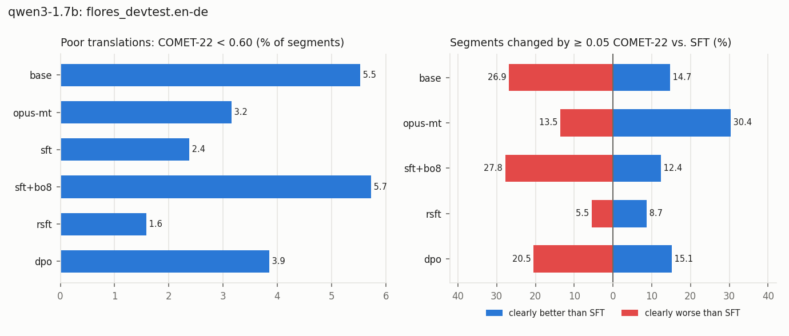

# Phase 3 results · held-out evaluation, over-optimization and exploits

Training reward: MetricX-24-QE. Held-out evaluator: COMET-22. Generated by `scripts/p3_analyze.py` from `results/p2/`; sections appear as their inputs exist.

## qwen3-1.7b

### A · Methods vs. SFT on flores_devtest.en-de (1012 segments)

COMET-22 never guided training (held out); MetricX-QE is the training reward. Δ = paired mean difference to `sft` with a 95% bootstrap CI (* = p < 0.05). *Gap* = training-reward gain minus held-out gain, both in units of SFT's segment SD: positive means the training reward improved more than held-out quality (over-optimization).

| System | COMET-22 ↑ (held out) | Δ vs SFT | MetricX-QE ↑ (trained on) | Δ vs SFT | Gap (SD) | chrF | BLEU | Inference cost |
|---|---|---|---|---|---|---|---|---|
| base | 0.805 | -0.020 [-0.025, -0.014] * | -1.61 | -0.18 [-0.31, -0.04] * | +0.13 | 53.4 | 22.9 | 1× |
| opus-mt | 0.847 | +0.022 [+0.016, +0.029] * | -1.28 | +0.15 [+0.02, +0.29] * | -0.18 | 63.6 | 36.1 | 1× |
| sft | 0.825 | – | -1.43 | – | – | 54.3 | 24.5 | 1× |
| sft+bo8 | 0.803 | -0.022 [-0.027, -0.017] * | -0.93 | +0.51 [+0.41, +0.62] * | +0.51 | 50.0 | 18.2 | 8 samples + 8 reward calls |
| rsft | 0.830 | +0.005 [+0.002, +0.008] * | -1.31 | +0.12 [+0.04, +0.21] * | +0.00 | 54.7 | 24.9 | 1× |
| dpo | 0.818 | -0.006 [-0.011, -0.001] * | -1.32 | +0.12 [+0.01, +0.23] * | +0.13 | 56.5 | 24.8 | 1× |

wmt24.en-de (paragraph-level): base 0.734 (-0.013 [-0.019, -0.007] *); opus-mt 0.733 (-0.014 [-0.024, -0.004] *); sft 0.747; sft+bo8 0.714 (-0.033 [-0.039, -0.027] *); rsft 0.752 (+0.005 [+0.002, +0.008] *); dpo 0.743 (-0.005 [-0.010, +0.001]).

### A2 · Beyond the average: the tails on flores_devtest.en-de

Mean differences hide where a method helps or hurts. Bands of COMET-22 per segment (% of segments), the mean of the worst 10% of segments, and the share of segments that are clearly (≥ 0.05) better or worse than SFT on the same sentence.

| System | poor % | weak % | fine % | very good % | Worst 10% mean | Better than SFT % | Worse than SFT % |
|---|---|---|---|---|---|---|---|
| base | 5.5 | 8.9 | 45.0 | 40.6 | 0.584 | 14.7 | 26.9 |
| opus-mt | 3.2 | 5.7 | 27.5 | 63.6 | 0.621 | 30.4 | 13.5 |
| sft | 2.4 | 7.2 | 41.9 | 48.5 | 0.633 | – | – |
| sft+bo8 | 5.7 | 10.3 | 42.3 | 41.7 | 0.580 | 12.4 | 27.8 |
| rsft | 1.6 | 7.0 | 42.3 | 49.1 | 0.646 | 8.7 | 5.5 |
| dpo | 3.9 | 7.6 | 42.3 | 46.2 | 0.608 | 15.1 | 20.5 |

Largest drops from SFT (all 20 per system in `<model>_worst_regressions_<system>.jsonl`):

> **sft+bo8**, COMET-22 -0.405, MetricX-QE -0.9 (other)  
> SRC In Japan, the first cherry blossom parties were hosted by the emperor only for himself and other members of the aristocracy around the Imperial Court.  
> SFT In Japan wurden die ersten Pflanzkonzerte des Frühlings nur für den Kaiser und andere Mitglieder der Aristokratie im Imperialen Palast veranstaltet.  
> SFT+BO8 In Japan waren die ersten Pflanztagungen mit frischen Pröschen nur einmal im Jahr, wie die Empress selbst und andere Mitglieder des kaiserlichen Adels dies im Vorderhut hergestellt

> **rsft**, COMET-22 -0.260, MetricX-QE -2.3 (other)  
> SRC They usually have special food, drink and entertainment offers, to keep guests in a good mood, and keep them at the premise.  
> SFT Sie bieten normalerweise besondere Mahlzeiten, Getränke und Unterhaltung an, um die Gäste in guter Stimmung zu halten und sie auf dem Gelände zu halten.  
> RSFT Sie bieten normalerweise besondere Mahlzeiten, Getränke und Unterhaltung an, um die Gäste in gutem Eilfach zu halten und sie auf dem Gelände zu halten.

> **dpo**, COMET-22 -0.392, MetricX-QE -8.9 (other)  
> SRC Several hostages have been rescued and least six have been confirmed dead so far.  
> SFT Viele Gefangene wurden entführt und bis jetzt sind mindestens sechs bestätigt tot.  
> DPO Einzahlungsschwestern wurden befreit und bisher sind wenigstens sechs bestätigt tot.

### B · Over-optimization

Best-of-k on FLORES dev (chosen by the training reward): k=1: MetricX-QE -2.88 / COMET-22 0.721, k=2: MetricX-QE -1.75 / COMET-22 0.760, k=4: MetricX-QE -1.15 / COMET-22 0.786, k=8: MetricX-QE -0.83 / COMET-22 0.805.

### C · Exploits

Share of outputs with each signal (%). *short* / *long* = under 70% / over 140% of the reference length (omission / addition proxies).

| System | wrong_language | number_mismatch | short | long | copy | repetition |
|---|---|---|---|---|---|---|
| base | 0.1 | 0.7 | 1.1 | 0.7 | 0.0 | 0.1 |
| opus-mt | 0.1 | 1.4 | 0.6 | 0.3 | 0.1 | 0.0 |
| sft | 0.3 | 1.2 | 1.4 | 1.0 | 0.3 | 0.2 |
| sft+bo8 | 0.0 | 1.5 | 1.1 | 2.7 | 0.0 | 0.0 |
| rsft | 0.0 | 1.1 | 1.2 | 0.8 | 0.0 | 0.1 |
| dpo | 0.0 | 1.3 | 0.0 | 4.8 | 0.0 | 0.1 |

**Suspicious wins** (training reward ≥ 1 point better than SFT, COMET-22 ≥ 0.02 worse), with the signals the RL output introduced:

- sft+bo8: 70 of 1012 segments — other 62, long 8
- rsft: 6 of 1012 segments — other 6
- dpo: 16 of 1012 segments — other 15, long 1

### F · Forgetting on untrained directions

RSFT, DPO and GRPO train on English→German only; SFT (v2) also on German→English, so German→English measures forgetting of a trained direction and English→Chinese an untrained one. *Wrong language* = the output is not in the target language; *near copy* = most character 4-grams of the output occur in the source (includes rewrites of the source in its own language); *exact copy* = the output is the source, verbatim.

| Test set | System | COMET-22 | chrF | BLEU | Wrong language % | Near copy % | Exact copy % |
|---|---|---|---|---|---|---|---|
| flores_devtest.de-en | base | 0.877 | 64.0 | 37.2 | 0.3 | 0.3 | 0.0 |
| flores_devtest.de-en | sft | 0.874 | 61.8 | 35.8 | 0.0 | 0.0 | 0.0 |
| flores_devtest.de-en | rsft | 0.875 | 61.9 | 35.7 | 0.0 | 0.0 | 0.0 |
| flores_devtest.de-en | dpo | 0.877 | 63.4 | 36.7 | 0.0 | 0.0 | 0.0 |
| flores_devtest.en-zh | base | 0.872 | 33.2 | 38.5 | 0.2 | 0.1 | 0.0 |
| flores_devtest.en-zh | sft | 0.628 | 5.0 | 2.5 | 94.3 | 93.3 | 34.9 |
| flores_devtest.en-zh | rsft | 0.639 | 6.0 | 4.0 | 90.0 | 88.7 | 30.7 |
| flores_devtest.en-zh | dpo | 0.821 | 27.0 | 31.4 | 19.6 | 19.2 | 4.9 |

Why: see the direction diagnostic in `results/p2/qwen3-1.7b/diagnostics/direction.md`.
